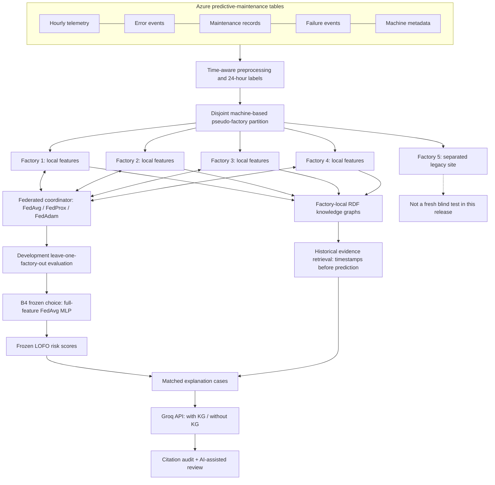
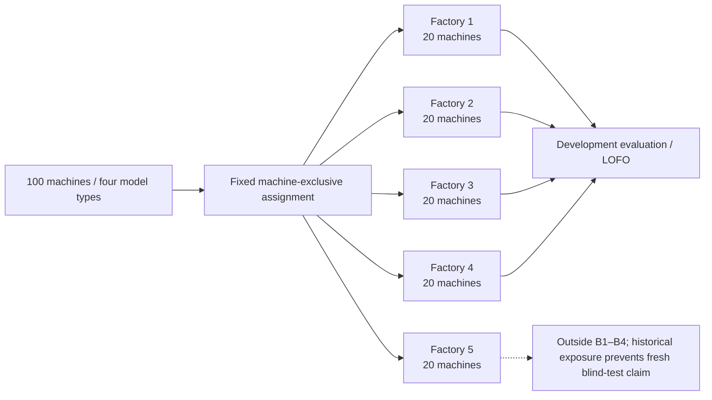
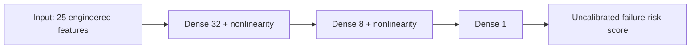
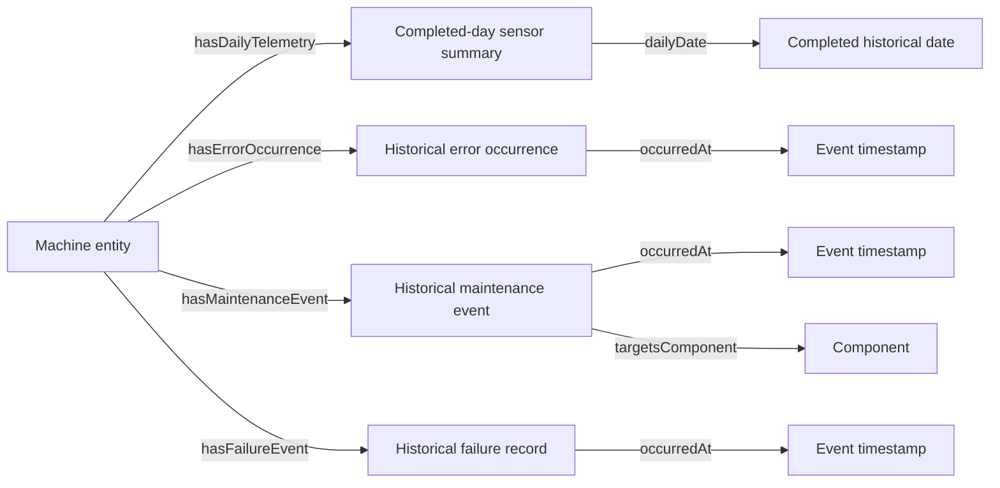
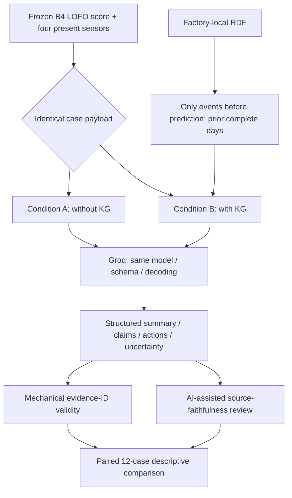

# FedKG-Maint

### Federated Predictive Maintenance with Local Knowledge Graphs and Evidence-Grounded LLM Explanations

**An experimental, cross-factory predictive-maintenance research pipeline** built around the Microsoft Azure Predictive Maintenance dataset. The project examines three connected questions: **(i)** can machine-failure warnings be learned without centrally pooling factory training records, **(ii)** how do feature availability, non-IID factory populations, and privacy mechanisms affect generalization, and **(iii)** can factory-local knowledge graphs improve the evidence grounding of LLM-generated maintenance explanations?

[](#scope-and-release-status) [](#repository-map) [](#study-iv--knowledge-graph-grounded-llm-explanations) [](#dataset-and-client-partitioning)

> **Research integrity / scope.** Results reported here are **development-study results**, not a new blind deployment evaluation. The frozen **B4** architecture choice is a **25-feature, 32–8 hidden-unit federated MLP trained by FedAvg**. B4 stores **four distinct leave-one-factory-out prediction sets**, not a single four-client fitted production checkpoint. Its selected model has **no DP guarantee**; conditional processed-record DP was investigated separately. **NASA C-MAPSS remains unimplemented.** Phase 5 has completed its 24 Groq responses and an **AI-assisted** review, **not an independent human evaluation**. These distinctions are part of the reported findings, not footnotes to be ignored.

## At a glance

| Dimension | Experimental scope / outcome |
|:--|:--|
| Prediction target | Binary **failure within the next 24 hours** at a machine-time observation |
| Data source | Microsoft Azure Predictive Maintenance sample (telemetry, machines, errors, maintenance, failures) |
| Simulated federation | 5 disjoint pseudo-factories, 20 machines per factory; **factories 1–4** used in the B1–B4 development LOFO study |
| Main development selection | **FedAvg + MLP (25→32→8→1)**, eight rounds and seed 42 in B4 pilot |
| B4 classification | **0.7623** mean PR-AUC; **0.7421** worst-factory PR-AUC; **0.0242** fold SD |
| B4 operational alerts | **40 / 46** eligible events identified; **27** false alerts over 2,756.67 machine-days at ≥12 h lead criterion |
| Knowledge graph | Five separate factory RDF graphs; time-filtered historical evidence for explanation |
| LLM evaluation | Groq `openai/gpt-oss-120b`, **12 matched cases × 2 conditions = 24 responses** |
| With vs without KG | Citation-ID coverage **99.24% vs 93.93%**; AI-assisted actionability **4.25 vs 3.33 / 5** |
| Important adverse observation | AI-assisted faithfulness **3.92 vs 5.00 / 5**, and **10 vs 0** flagged unsupported statements, **with KG vs without KG** |

---

## 1. Problem statement

Industrial equipment generates time-indexed measurements and operational events, but failure examples are infrequent, maintenance histories are heterogeneous, and an operator needs **actionable warning with reasonable false-alarm burden**, not simply a good global classifier. Centralizing factory records may be undesirable or impractical. Even when an ML system raises a risk score, describing *why* that score is concerning is difficult: model correlations, historical maintenance records, and actual physical causes are distinct notions of evidence.

This study models the challenge as **federated temporal classification plus evidence-grounded explanation**. For machine \(m\) at timestamp \(t\), the target is:

\[
y_{m,t}=\mathbb{1}\{\text{at least one logged failure in }(t,t+24\,\mathrm{h}]\}.\]

The system constructs time-consistent features \(x_{m,t}\), learns a scalar risk score \(s_\theta(x_{m,t})\), and supplies a separate, **strictly historical** evidence packet to the LLM. **The output score is not a calibrated probability of failure**, and the knowledge graph is **not a causal explanation of model weights**.

### Research questions

- **RQ1 — Cross-factory robustness.** How do centralized baselines, federated optimizers, and temporal architectures generalize to development factories held out during training?
- **RQ2 — Feature dependence.** How much performance is lost if maintenance or wider operational context is absent?
- **RQ3 — Operational utility.** Can warnings be evaluated at event level under a fixed false-alert constraint and a minimum lead-time requirement?
- **RQ4 — Privacy scope.** What utility remains under a *conditional* processed-record-level DP mechanism, and what privacy claims are not justified?
- **RQ5 — Explanatory grounding.** What changes when the same LLM receives historical factory RDF evidence in addition to the same present observations and frozen risk score?

### Contributions, stated at the demonstrated level

1. A reproducible **five-factory simulation** with explicit machine isolation, time splits, label-horizon controls, and machine-level heterogeneity diagnostics.
2. Baseline and federated **feature, optimizer, and architecture comparisons** with PR-AUC and factory-level robustness reported separately.
3. A **12-hour-advance operational warning audit** using false alarms per machine-day and detected failure events.
4. Factory-local RDF graphs and **time-safe evidence retrieval** that keep future incidents outside explanation prompts.
5. An executed **paired LLM study**, distinguishing citation-ID validity from semantic faithfulness and explicitly documenting adverse outcomes from adding KG context.

## 2. End-to-end research architecture



**Privacy boundary:** The conceptual federated system exchanges model information, not pooled raw factory training tables. **The simulated experiment is not evidence of cryptographic secure aggregation or end-to-end raw-data privacy.** Phase 5 transmits selected sensor/evidence snippets to a third-party LLM provider; assess authorization for any real industrial deployment.

## 3. Dataset and client partitioning

The [Microsoft Azure Predictive Maintenance sample](https://github.com/microsoft/azure-predictive-maintenance) supplies five relational tables. Checks in the committed preprocessing report record **100 machines**, **876,100 telemetry records**, **3,919 error events**, **761 failure records**, and **3,286 maintenance records**. Telemetry is hourly across the covered one-year simulation interval. These numbers refer to the studied sample and should not be generalized to a production failure distribution.

| Input | Records reported | Use |
|---|---:|---|
| `PdM_telemetry.csv` | 876,100 | Voltage, rotation, pressure, vibration time series |
| `PdM_machines.csv` | 100 | Machine ID, model, age and partition context |
| `PdM_errors.csv` | 3,919 | Historical error events |
| `PdM_maint.csv` | 3,286 | Component maintenance history |
| `PdM_failures.csv` | 761 | Event timestamps for future-horizon labels |

**Preprocessing safeguards.** The source audit checks time alignment, missing/duplicate observations, event labeling consistency, machine exclusivity, and 24-hour gaps at development time boundaries. The last 24 rows of each machine, for which the full future target horizon is not observable, are excluded from relevant labeled targets. Training-fitted transformations must not leak future or held-out statistics. Check the exact split definitions and their exceptions in the [`prep_v3` protocol](results/original_drive_reports/unified_runs/unified_v3_final_20261025/prep_v3/configs/preprocessing_protocol.json) rather than assuming generic chronological cross-validation.

### Simulated non-IID federation



| Development client | Machines | Model 1 | Model 2 | Model 3 | Model 4 | Training positive prevalence |
|---|---:|---:|---:|---:|---:|---:|
| Factory 1 | 20 | 40% | 20% | 20% | 20% | 2.48% |
| Factory 2 | 20 | 20% | 35% | 25% | 20% | 2.12% |
| Factory 3 | 20 | 10% | 15% | 50% | 25% | 2.02% |
| Factory 4 | 20 | 5% | 10% | 40% | 45% | 1.76% |

The observed variation in machine-model composition and target prevalence creates an **engineered non-IID setting**. These factories are **simulated partitions of one public dataset**, not independent real industrial sites.

## 4. Model families and optimization

### Prediction architecture

The selected **B4 pilot** model is a small fully connected classifier operating on the full 25-feature engineering vector:



The benchmark also tests an **LSTM** with 24-hour temporal windows and smaller feature variants. The exact layer implementations, pooling, initialization and parameterization belong to the notebooks (do not infer them from this conceptual diagram). In the B4 pilot, the controlled comparisons use **8 communication rounds**, **seed 42**, **up to 6,000 training endpoints per participating client**, **batch size 512**, and a **24-hour input window**. The development experiment comprises **4 held-out factories × 3 feature variants × 2 architectures = 24 runs**.

### Federated-learning families

For \(K\) participating factories and local solutions \(\theta_k^{(r+1)}\), FedAvg forms:

\[
\theta^{(r+1)}=\sum_{k=1}^{K}\frac{n_k}{\sum_j n_j}\theta_k^{(r+1)}.
\]

- **FedAvg** aggregates local parameter updates using dataset-size-based weighting.
- **FedProx** adds a local proximal penalty \(\tfrac{\mu}{2}\|\theta-\theta^{(r)}\|_2^2\) to discourage excessive drift from the current global model.
- **FedAdam** applies adaptive server-side optimization to aggregated updates.
- **Centralized and local-only comparators** help interpret the cost and benefits of federation under the same simulated data organization.

The reported optimizer sweep and the B4 architecture pilot are **separate experimental protocols**. Their metric values must not be treated as a single, controlled head-to-head ranking unless their split, feature, budget and seed definitions match.

### Full and reduced feature groups

| Variant | Research interpretation |
|---|---|
| `full` | All 25 approved engineered features, including the operational history available in that protocol |
| `no_maintenance` | Maintenance-derived information excluded |
| `sensor_history_only` | Narrower sensor/history view; substantial operational context removed |

The B1 label `sensor_errors` is an **alias/equivalent grouping** to its `no_maintenance` group in that study; it is **not a fourth independent ablation**.

## 5. Evaluation protocol and metrics

**Primary ranking metric: PR-AUC / Average Precision (AP).** Positive outcomes are relatively rare, so ROC-AUC is retained for context but should not be the only basis for selection. We report **mean across development factories**, **worst-factory AP**, and **fold-to-fold dispersion** to expose site sensitivity.

**Development LOFO:** for each development fold, one of factories 1–4 is held out and the others supply training examples. The four scores are evaluated on their corresponding held-out factory endpoints. They represent **four fitted fold-specific models**.

**Operational alert study:** score thresholds are selected from *other development folds* under a target **≤0.10 false alarms per machine-day**. The evaluation counts alerts using a **minimum 12 h actionable lead time** and **24 h cooldown**. A detected event is counted separately from pointwise classification; false-alert rate uses machine-days as its denominator. The actual test-time counted alert burden is shown below; the budget is a **selection constraint**, not an observed model accuracy guarantee.

### Study I — Feature importance: HGB LOFO diagnostic baseline (B1)

| Input grouping | Mean PR-AUC | Lowest-factory PR-AUC | Fold SD |
|---|---:|---:|---:|
| Full | **0.9756** | **0.9252** | 0.0339 |
| No maintenance (`sensor_errors` equivalent) | 0.7767 | 0.7059 | 0.0493 |
| Sensor/history only | 0.2442 | 0.1943 | 0.0476 |

This is an **HGB diagnostic study**, **not** evidence that the selected federated B4 architecture reaches 0.9756 AP. Full operational records are much more informative in this dataset than stripped sensor/history views. **Potentially strong predictive maintenance-history signals require careful temporal and leakage inspection**, particularly when same-time maintenance can accompany logged failure events.

_Source: [`B1_hgb_lofo_summary.csv`](results/original_drive_reports/unified_runs/phaseB_development_v1/results/B1_hgb_lofo_summary.csv)._

### Study II — Initial temporal federated comparison (B2)

| Architecture | Mean PR-AUC | Worst-factory PR-AUC | SD |
|---|---:|---:|---:|
| MLP | 0.5737 | **0.4013** | **0.1229** |
| LSTM | **0.5777** | 0.2129 | 0.2187 |

The two means are similar in this earlier protocol, but LSTM shows substantially greater cross-factory instability. **This study motivated a focused B4 pilot**, not a claim that all LSTM architectures are inferior.

_Source: [`B2_federated_temporal_summary.csv`](results/original_drive_reports/unified_runs/phaseB_development_v1/results/B2_federated_temporal_summary.csv)._

### Study III — Frozen B4 development pilot


| Feature set | Architecture | Mean PR-AUC | Worst-factory PR-AUC | SD |
|---|---|---:|---:|---:|
| Full | **MLP** | **0.7623** | **0.7421** | **0.0242** |
| Full | LSTM | 0.7303 | 0.5292 | 0.1379 |
| No maintenance | MLP | 0.6136 | 0.5686 | 0.0409 |
| No maintenance | LSTM | 0.6057 | 0.3670 | 0.1611 |
| Sensor/history only | MLP | 0.2812 | 0.1856 | 0.0783 |
| Sensor/history only | LSTM | 0.2425 | 0.1271 | 0.1147 |


**Full-feature per-factory PR-AUC** makes the choice transparent:

| Held-out development factory | MLP | LSTM |
|---|---:|---:|
| Factory 1 | 0.7964 | **0.8422** |
| Factory 2 | 0.7421 | **0.7680** |
| Factory 3 | 0.7623 | **0.7818** |
| Factory 4 | **0.7485** | 0.5292 |

The LSTM is better in the first three of these four factories, yet its loss of robustness on Factory 4 makes **MLP more stable overall** for the pilot's stated multi-factory operating objective. The decision is a **robustness choice, not a universal neural-architecture result**.

_Source: [`B4_model_summary.csv`](results/original_drive_reports/unified_runs/phaseB4_generalization_pilot_v1/results/B4_model_summary.csv) · [`B4_model_fold_metrics.csv`](results/original_drive_reports/unified_runs/phaseB4_generalization_pilot_v1/results/B4_model_fold_metrics.csv) · [frozen decision record](results/original_drive_reports/unified_runs/phaseB4_generalization_pilot_v1/reports/B4_generalization_decision.json)._

#### Operational early-warning evaluation

| Full-feature B4 model | Eligible failure events | Detected | Event recall | False alerts | False alarms / machine-day |
|---|---:|---:|---:|---:|---:|
| **FedAvg MLP** | 46 | **40** | **86.96%** | **27** | **0.00979** |
| FedAvg LSTM | 46 | 36 | 78.26% | 55 | 0.01995 |

Both rows aggregate **2,756.67 machine-days** of development-fold observation. The operational comparison strengthens the engineering case for the MLP under the reported conditions; it **does not establish future operational reliability** on unseen industrial deployments.

_Source: [`B4_operational_summary.csv`](results/original_drive_reports/unified_runs/phaseB4_generalization_pilot_v1/results/B4_operational_summary.csv) · [cross-fold alert details](results/original_drive_reports/unified_runs/phaseB4_generalization_pilot_v1/results/B4_cross_fold_alert_metrics.csv)._

### Separate federated optimizer sweep (Unified v3)

| Optimizer | Rounds | Mean LOFO AP | Worst-factory AP |
|---|---:|---:|---:|
| FedAvg | 6 | 0.6032 | 0.5202 |
| FedAvg | 12 | 0.7355 | 0.7044 |
| **FedAvg** | **18** | **0.7769** | **0.7325** |
| FedProx | 18 | 0.7757 | 0.7283 |
| FedAdam | 18 | 0.5505 | 0.1365 |

This is a **distinct optimizer-round development sweep**, not the fixed eight-round B4 pilot. In this protocol, FedAvg and FedProx were close at 18 rounds; FedAdam was less stable. No cross-protocol superiority or formal statistical significance is asserted.

_Source: [`federated_lofo_summary.csv`](results/original_drive_reports/unified_runs/unified_v3_final_20261025/v3_federated/results/federated_lofo_summary.csv)._

## 6. Differential privacy: actual mechanism and claim boundaries

A *separate* Unified v3 experiment tested **Poisson-subsampled per-example clipped gradients with Gaussian noise** and an RDP accountant. The reported configuration used clipping norm **1**, Gaussian noise multiplier **1.5**, **4 rounds**, \(\delta=10^{-5}\), and **maximum reported \(\varepsilon\approx0.623\)** across the development clients, **conditional on the explicitly declared processed-row adjacency and fixed preprocessing/sampling assumptions**.

| Reported comparison | Validation AP |
|---|---:|
| Non-private comparator in this privacy protocol | 0.8159 |
| Conditional processed-record DP configuration | 0.6809 |
| Relative utility (DP / comparator) | 83.45% |

**Do not extrapolate:** this is **not** end-to-end differential privacy for raw maintenance logs, non-private preprocessing and scalers, factory participation, KG content, LLM prompts, or **B4's selected MLP**. Secure aggregation, where simulated, is **not cryptographic proof**. The reported epsilon is conditional and should be interpreted only with the recorded mechanism and release assumptions; a universal privacy guarantee is not asserted.

_Source: [`dp_release_manifest.json`](results/original_drive_reports/unified_runs/unified_v3_final_20261025/v3_federated/reports/dp_release_manifest.json) · [`privacy_utility_result.json`](results/original_drive_reports/unified_runs/unified_v3_final_20261025/v3_federated/reports/privacy_utility_result.json)._

## 7. Local RDF knowledge graphs and time-safe evidence

Each simulated factory receives a separate RDF graph. The graphs describe machine entities, daily aggregated telemetry, error occurrences, maintenance events, failure records, and associated components/timestamps. A **shared ontology** promotes a common schema; individual factory graph contents remain separate in the experiment design.



| Graph | Machines | RDF triples |
|---|---:|---:|
| Factory 1 | 20 | 162,111 |
| Factory 2 | 20 | 161,956 |
| Factory 3 | 20 | 161,876 |
| Factory 4 | 20 | 161,441 |
| Factory 5 | 20 | 162,051 |

**Temporal safety:** at prediction time \(t\), retrieved event facts must satisfy \(t_\mathrm{event}<t\). Completed-day aggregates are constrained to **earlier complete days**; same-day incomplete daily aggregates are not supplied as historical evidence. The Phase 5 retrieval uses a bounded recent-history window and IDs (`KG-001`, etc.) that the LLM may cite. **Historical association does not establish fault causation or the mechanism underlying a neural prediction.**

_Source: [RDF graph statistics](results/original_drive_reports/unified_runs/unified_v3_final_20261025/phase4_local_knowledge_graphs_v1/reports/factory_graph_statistics.csv) · [ontology Turtle](results/original_drive_reports/unified_runs/unified_v3_final_20261025/phase4_local_knowledge_graphs_v1/ontology/fedkg_shared_ontology.ttl)._

## 8. Study IV — Knowledge-graph-grounded LLM explanations

### Experimental design

Twelve development cases were selected by a fixed algorithm: **low / median / high risk-ranked observations** from each of four factories, using distinct machines within each factory, and *without selecting on future failure labels*. Each case was presented under two matched conditions:

1. **Without KG:** frozen LOFO score, prediction time, and four current sensor measurements with `PRED-*` / `OBS-*` evidence identifiers.
2. **With KG:** identical case, same sensor values and risk score, **plus** the temporally filtered RDF evidence records `KG-*`.

The same `openai/gpt-oss-120b` model on the **Groq API**, JSON schema, instructions, and decoding settings were used for both conditions. The experiment generated **24/24 structured responses**, saved individually and restartably. It did **not** re-train the prediction model or make external judge-model calls. Groq is a third-party processor for the selected historical/operational snippets.



### Outcomes: evidence identifiers are not evidence entailment


| Measure (12 responses / condition) | Without KG | With KG | Interpretation |
|---|---:|---:|---|
| Mean citation-ID coverage | 93.93% | **99.24%** | Fraction of claims/actions with nonempty IDs all found in that prompt |
| Invalid citation-ID references | 0 | 0 | Referenced IDs existed, but some entries had no citations |
| Distinct KG IDs cited (summed across cases) | 0 | **127** | Historical context was used, not proof of factual correctness |
| Explicit uncertainty field | 12 / 12 | 12 / 12 | Schema presence, not full calibration of uncertainty |
| Actionability, AI-assisted mean / 5 | 3.33 | **4.25** | More specific and practical inspection suggestions |
| Faithfulness, AI-assisted mean / 5 | **5.00** | 3.92 | Added historical facts sometimes introduced numeric/date mistakes |
| Unsupported statements flagged by AI review | **0** | 10 | Descriptive count requiring independent verification |
| Unsafe-advice flags in AI review | 0 | 0 | Does not certify industrial safety |

The mechanical citation coverage change is **+5.31 percentage points** in this small evaluation. Its numerator checks existence and completeness of evidence identifiers, **not whether cited evidence supports the statement**. The AI-assisted review found wrong numerical summaries, unsuitable source attribution, or inaccurate historical comparisons in some With-KG cases. Accordingly, **we do not claim that KG improves faithfulness**; in this sample the evidence suggests an **actionability–faithfulness trade-off**. Without an independent blinded human evaluation, the subjective scores remain **AI-assisted descriptive annotations**, not human-validated ground truth.

_Source: [raw mechanical aggregate rows](results/original_drive_reports/unified_runs/phase5_groq_grounded_v1/results/phase5_mechanical_metrics.csv) · [original Phase 5 run report](results/original_drive_reports/unified_runs/phase5_groq_grounded_v1/reports/PHASE5_REPORT.json) · [AI-assisted review aggregate](results/reported/Phase5_AI_Assisted_Aggregate_reported.csv) · [paired review summary](results/reported/Phase5_AI_Assisted_Paired_reported.csv). Individual prompts and generated answers are retained outside this public release._

## 9. Methodological interpretation and threats to validity

| Threat / limitation | Implication |
|---|---|
| **Simulated factories** | Machine-disjoint partitions share the same original simulator/data source; not equivalent to truly independent enterprises. |
| **Development model selection** | B4 was selected using LOFO development results and one seed; its reported numbers are **not** untouched external-test performance. |
| **Factory 5 history** | Although excluded from the B1–B4 pilot, it was touched in earlier project iterations; it cannot honestly be advertised as a fresh blind factory. |
| **Maintenance-history signal** | Near-time maintenance/failure associations can be highly predictive and may create deployment or leakage concerns if event availability is not audited. |
| **Few operational events** | Only 46 eligible events were included in the selected B4 operational comparison; event recall is sample-sensitive. |
| **Uncalibrated risk output** | A score of 0.9 is **not** a demonstrated 90% chance of a future failure. |
| **Single final checkpoint missing** | Four fold-specific LOFO prediction archives do **not** constitute a retrained deployable model trained on all four development clients. |
| **Differential privacy boundary** | The conditional DP experiment does not apply to the frozen B4 MLP, raw source records, RDF graph, or Groq payloads. |
| **KG explanation fidelity** | A historically correct graph statement is not a causal or feature-attribution explanation of the classifier. |
| **LLM subjective evaluation** | AI-assisted reviews are not independent blinded human evaluation; 12 chosen cases do not justify inferential superiority claims. |
| **NASA benchmark** | The original project specification also includes NASA C-MAPSS RUL; **not implemented** in this release. |

A more rigorous next-stage study would require prospective factory-level holdout, independent reviewer agreement, a documented security and data-governance process, calibrated alert policies, and a final checkpoint with its own evaluation. **Those steps are not silently counted as completed.**

## 10. Reproduction and artifact provenance

### Repository map

```text
FedKG-Maint/
├── README.md                            ← this research overview
├── README_EN.md                         ← shorter English overview
├── requirements.txt
├── notebooks/
│   ├── 00_MASTER_Integration.ipynb
│   ├── core/01_Unified_v3_Phases_1_to_4.ipynb
│   ├── experiments/02_B1_B3_Feature_and_Temporal_FL.ipynb
│   ├── experiments/03_B4_Generalization_Pilot.ipynb
│   ├── phase5/04_Phase5_Groq_KG_Explanations.ipynb
│   ├── phase_details/                   ← independent phase notebooks
│   └── upcoming_not_executed/           ← legacy draft, not completion evidence
├── results/
│   ├── original_drive_reports/          ← 51 byte-preserved original reports/configs
│   └── reported/                        ← curated descriptive tables
├── docs/
│   ├── figures/                         ← README graphics
│   ├── ARCHITECTURE.md
│   ├── REPRODUCIBILITY.md
│   ├── PRIVACY_AND_PUBLICATION.md
│   └── ORIGINAL_REQUIREMENTS_CHECKLIST.md
├── reports/                              ← interpretive study reports
├── scripts/                              ← repository validation scripts
├── tests/                                ← static correctness tests
└── archive/legacy_notebooks/             ← prior experimental versions
```

**Provenance.** The [`original_drive_reports/` directory](results/original_drive_reports/) contains the selected exported **51 original small files**, a manifest, and recorded SHA-256 digests. The tables are **empirical output artifacts** from the user's prior Colab executions, not figures recomputed by the GitHub static validator. The charts in this README are rendered from the committed summary tables. Source notebooks have been sanitized to omit saved cell outputs; do not interpret an empty output pane as proof a reported experiment was never run.

### Quick start

```bash
git clone https://github.com/obaidah3/FedKG_Maint.git
cd FedKG_Maint
python -m venv .venv
# Windows: .venv\\Scripts\\activate
# macOS/Linux: source .venv/bin/activate
pip install -r requirements.txt
python scripts/validate_repo.py
python -m unittest discover -s tests -v
```

The historical training notebooks were primarily **Google Colab + Google Drive workflows**. Their original runtime inputs assume a root such as:

```text
/content/drive/MyDrive/FedKG-Maint/unified_runs/
  unified_v3_final_20261025/
  phaseB_development_v1/
  phaseB4_generalization_pilot_v1/
  phase5_groq_grounded_v1/
```

The public repository **does not contain** source CSVs, processed private/runtime parquet splits, per-factory RDF TTL graph contents, runtime B4 `.npz` predictions, Groq raw response files, or a final retrained global B4 checkpoint. For full reproduction, obtain the original public dataset and execute the specific notebooks with compatible runtime assumptions and artifact paths, keeping train/validation partitions and temporal protocols consistent. **Running the static tests alone does not reproduce the reported performance numbers.**

**Groq API key:** if regenerating LLM responses, create `GROQ_API_KEY` in Colab Secrets or a secure environment variable. Never put credentials in `.ipynb`, `.env` committed to Git, logs or screenshots. The executed 24 requests already exist in the owner's private Drive artifact store; rerunning them is **unnecessary** for publishing the documented results. See [`PHASE5_RUNBOOK.md`](docs/PHASE5_RUNBOOK.md).

### Key evidence links

- [Frozen B4 pilot decision](results/original_drive_reports/unified_runs/phaseB4_generalization_pilot_v1/reports/B4_generalization_decision.json)
- [B4 fold-level metrics](results/original_drive_reports/unified_runs/phaseB4_generalization_pilot_v1/results/B4_model_fold_metrics.csv)
- [B4 operational event-level metrics](results/original_drive_reports/unified_runs/phaseB4_generalization_pilot_v1/results/B4_operational_summary.csv)
- [Unified v3 preprocessing audit](results/original_drive_reports/unified_runs/unified_v3_final_20261025/prep_v3/reports/data_prep_final_report.json)
- [DP accounting / release manifest](results/original_drive_reports/unified_runs/unified_v3_final_20261025/v3_federated/reports/dp_release_manifest.json)
- [KG graph statistics](results/original_drive_reports/unified_runs/unified_v3_final_20261025/phase4_local_knowledge_graphs_v1/reports/factory_graph_statistics.csv)
- [Groq Phase 5 report](results/original_drive_reports/unified_runs/phase5_groq_grounded_v1/reports/PHASE5_REPORT.json)
- [Detailed project limitations](docs/RELEASE_STATUS.md) / [requirements status](docs/ORIGINAL_REQUIREMENTS_CHECKLIST.md)

## 11. Research status and responsible reuse

| Component | Status in this release |
|---|---|
| Data preprocessing, diagnostics, baseline studies | Executed; original small reports exported |
| Federated optimizer studies and conditional DP research | Executed in their recorded experimental configurations |
| Local RDF ontology and factory KG construction | Executed; graph counts and ontology exported |
| B1–B4 development comparisons and B4 MLP selection | Executed and frozen; not a blind deployment evaluation |
| Groq paired explanation generation and citation-ID audit | **Completed 24/24**, with 12 evidence-bearing KG cases |
| AI-assisted evaluation of 24 outputs | Completed; **not** independent human review |
| Independent human evaluation | **Not completed** |
| Final all-client retrained B4 production checkpoint | **Not delivered** |
| NASA C-MAPSS RUL validation | **Not implemented** |

**Reproducibility statement.** Research reports, source notebooks, and provenance checks are shared to make the work inspectable. No guarantee of out-of-the-box full reproduction without large Drive artifacts, original sample data and aligned environment versions is implied. Do not apply these models directly to hazardous industrial operations without independent verification, calibration, and domain-specific safety engineering.

**License:** see the existing [repository `LICENSE`](https://github.com/obaidah3/FedKG_Maint/blob/main/LICENSE). This release intentionally preserves the repository's existing license rather than assigning a new one.

---

*Project: FedKG-Maint · Azure research release, Phases 1–5 · 29 October 2026. Performance values are linked to source reports and should always be cited with their specific experimental protocol.*
