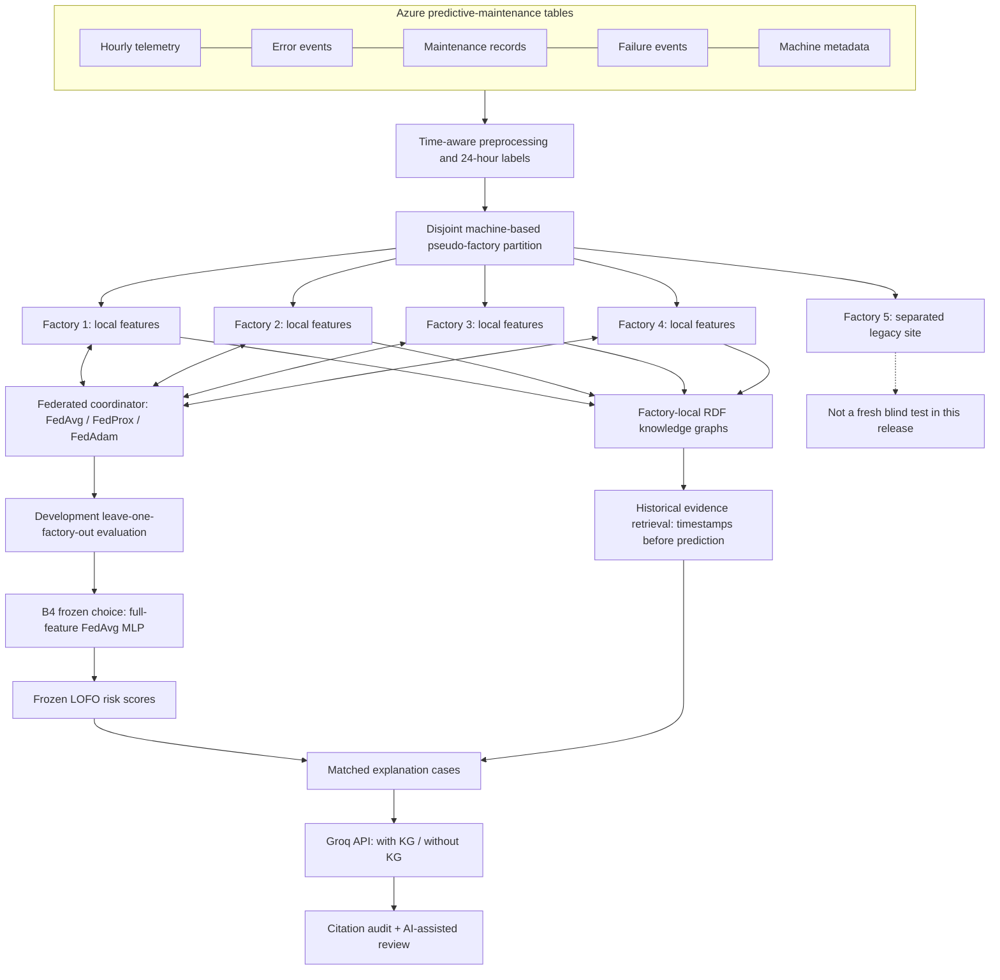
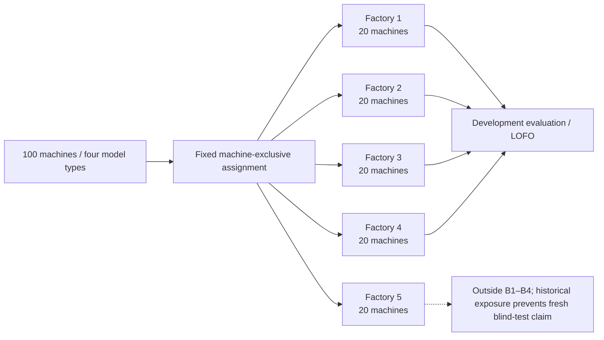
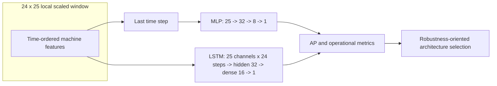
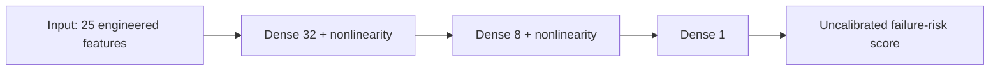
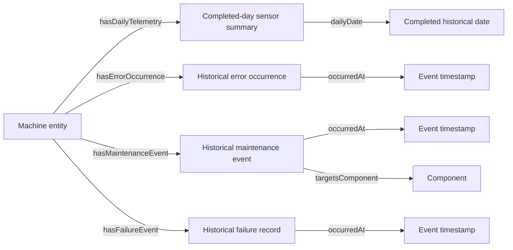
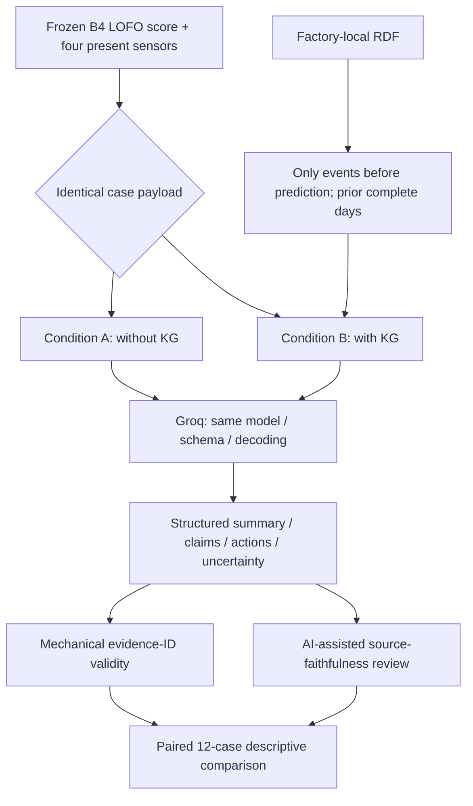
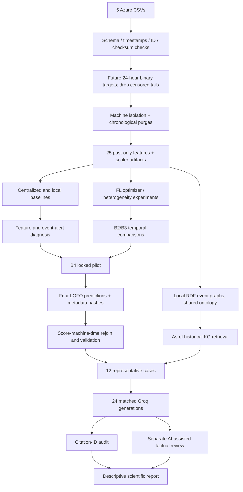

# FedKG-Maint

### Federated Predictive Maintenance with Local Knowledge Graphs and Evidence-Grounded LLM Explanations

**An experimental, cross-factory predictive-maintenance research pipeline** built around the Microsoft Azure Predictive Maintenance dataset. The project examines three connected questions: **(i)** can machine-failure warnings be learned without centrally pooling factory training records, **(ii)** how do feature availability, non-IID factory populations, and privacy mechanisms affect generalization, and **(iii)** can factory-local knowledge graphs improve the evidence grounding of LLM-generated maintenance explanations?

[](#scope-and-release-status) [](#repository-map) [](#study-iv--knowledge-graph-grounded-llm-explanations) [](#dataset-and-client-partitioning)

> **Research integrity / scope.** Results reported here are **development-study results**, not a new blind deployment evaluation. The frozen **B4** architecture choice is a **25-feature, 32–8 hidden-unit federated MLP trained by FedAvg**. B4 stores **four distinct leave-one-factory-out prediction sets**, not a single four-client fitted production checkpoint. Its selected model has **no DP guarantee**; conditional processed-record DP was investigated separately. **NASA C-MAPSS remains unimplemented.** Phase 5 has completed its 24 Groq responses and an **AI-assisted** review, **not an independent human evaluation**. These distinctions are part of the reported findings, not footnotes to be ignored.


## Abstract

**Background.** Cross-site predictive maintenance faces a three-way challenge: faults are rare and time-dependent, industrial data may not be centrally pooled, and operators need defensible explanations rather than unsupported root-cause stories. **Objective.** FedKG-Maint investigates federated failure-risk modeling under simulated inter-factory shifts, then tests whether historical, factory-local RDF knowledge improves the *evidence support* of maintenance narratives. **Methods.** Five mutually exclusive machine groups were constructed from the public Azure Predictive Maintenance sample; four formed a development leave-one-factory-out (LOFO) evaluation. We evaluated diagnostic centralized baselines, different information sets, temporal MLP/LSTM models, federated optimizers, conditional record-DP, and event-level alerting. Phase 5 held 12 model cases fixed and compared 24 paired explanations using Groq with versus without historical graph evidence. **Results.** In the fixed B4 pilot (8 FedAvg rounds, seed 42), the full-feature MLP achieved mean development PR-AUC **0.7623** and worst-factory PR-AUC **0.7421**, detecting **40/46** eligible failures at an audited false-alert rate of **0.00979 per machine-day**. The KG condition increased mean citation-ID coverage from **93.93% to 99.24%** and provisional AI-assisted actionability from **3.33 to 4.25/5**, but decreased provisional faithfulness from **5.00 to 3.92/5**. **Conclusion.** The evidence supports a carefully bounded engineering workflow and a qualified explanation trade-off, **not** claims of deployment readiness, end-to-end privacy, external-site generalization, or universal improvement from KG augmentation.

**Keywords:** predictive maintenance; federated learning; FedAvg; FedProx; FedAdam; non-IID clients; temporal leakage; differential privacy; knowledge graphs; RDF; retrieval-augmented generation; maintenance explanations; PR-AUC.

**How to read this document.** The main text is organized as a research manuscript while also recording the *implementation provenance*: source filenames, why each design was chosen, experimental locks, observed failures, and the precise current repository layout. Published research is cited with live links; measured project figures link to committed original output artifacts. **No synthetic/new results have been invented for this README.**

---

## At a glance

| Dimension | Experimental scope / outcome |
|:--|:--|
| Prediction target | Binary **failure within the next 24 hours** at a machine-time observation |
| Data source | Microsoft Azure Predictive Maintenance sample (telemetry, machines, errors, maintenance, failures) |
| Simulated federation | 5 disjoint pseudo-factories, 20 machines per factory; **factories 1–4** used in the B1–B4 development LOFO study |
| Main development selection | **FedAvg + MLP (25→32→8→1)**, eight rounds and seed 42 in B4 pilot |
| B4 classification | **0.7623** mean PR-AUC; **0.7421** worst-factory PR-AUC; **0.0242** fold SD |
| B4 operational alerts | **40 / 46** eligible events identified; **27** false alerts over 2,756.67 machine-days at ≥12 h lead criterion |
| Knowledge graph | Five separate factory RDF graphs; time-filtered historical evidence for explanation |
| LLM evaluation | Groq `openai/gpt-oss-120b`, **12 matched cases × 2 conditions = 24 responses** |
| With vs without KG | Citation-ID coverage **99.24% vs 93.93%**; AI-assisted actionability **4.25 vs 3.33 / 5** |
| Important adverse observation | AI-assisted faithfulness **3.92 vs 5.00 / 5**, and **10 vs 0** flagged unsupported statements, **with KG vs without KG** |

---


## Research development history and decision lineage

This is a **methodological history**, reconstructed from versioned notebooks, saved audit files, experiment locks and the retained research archive. It is **not** a claim that every iteration was independently published, prospectively registered, or run on a specific calendar date unless an artifact records that date. Labels such as `v1`, `v2`, `v3`, `B1`, and `B4` identify code/experiment generations; they are **not comparable leaderboard entries** by themselves.

```mermaid
flowchart LR
  A[Early data preparation and isolated baselines] --> B[Revised preprocessing v2 / v3]
  B --> C[FL and privacy prototypes: FedAvg, FedProx, FedAdam, DP]
  C --> D[Unified v1 / v2 integration and audits]
  D --> E[Unified v3: frozen data and temporal contracts]
  E --> F[B1: feature dependence and HGB diagnosis]
  F --> G[B2/B3: temporal MLP vs LSTM and paired checks]
  G --> H[B4: controlled 24-run pilot and operational alerts]
  H --> I[Freeze MLP architecture; verify scored folds]
  I --> J[Local RDF evidence + Master integration]
  J --> K[Phase 5: 24 Groq responses + evidence audit]
  K --> L[Research release and documented limitations]
```



| Documented iteration | Problem / observation that motivated it | Change made and the reason | Evidence and what it did **not** prove |
|---|---|---|---|
| **Early Phase 1 / v2** | Need consistent machine-time keys, features and train/validation splits | Prepared the five Azure tables, split data by time and began maintaining preprocessing/scaler artifacts | Historical notebooks remain under [`archive/legacy_notebooks/`](archive/legacy_notebooks/); these are provenance, not the adopted final protocol |
| **Revised `prep_v3`** | Risk of target leakage, inconsistent non-IID partitions, unobservable prediction horizons and inappropriate scaler fitting | Added machine-disjoint manifests, 24-hour horizon purge, past-only features, split auditing and held-out feature-only normalization | [Data preparation audit](results/original_drive_reports/unified_runs/unified_v3_final_20261025/prep_v3/reports/data_prep_final_report.json) records **passing checks**; no claim of zero possible real-world leakage |
| **Phase 2 baseline revisions** | A neural FL score is uninterpretable without strong centralized/local comparisons | Added logistic regression, HGB and diagnostic input ablations; separated raw physical-unit models from scaled neural inputs | See [baseline selection lock](results/original_drive_reports/unified_runs/unified_v3_final_20261025/v3_diagnostics_baselines/reports/development_selection_lock.json); HGB does **not** become the FL final model |
| **Phase 3 FL / privacy iterations** | Client heterogeneity, sensitivity to optimizers, and over-broad early privacy language | Compared FedAvg, FedProx and adaptive server optimizers; studied clipping, DP utility and normalization assumptions; retained unsuccessful/earlier variants for transparency | Original conditional [DP release manifest](results/original_drive_reports/unified_runs/unified_v3_final_20261025/v3_federated/reports/dp_release_manifest.json) limits protection to a separate preprocessed-record experiment |
| **Unified v1/v2 → Unified v3** | Multiple evolving notebooks made independent results easy to mix across protocols | Consolidated data, baselines, FL and KG around locked v3 sources, hashed inputs and recorded report locations | [Unified v3 audit](results/original_drive_reports/unified_runs/unified_v3_final_20261025/FINAL_V3_AUDIT.json); not every historical notebook is required for a final run |
| **B1 diagnostic study** | Strong full-feature performance suggested sensitivity to recorded maintenance context | Explicitly contrasted full, no-maintenance and sensor/history information, and inspected event-level usefulness | [B1 results](results/original_drive_reports/unified_runs/phaseB_development_v1/results/B1_hgb_lofo_summary.csv); same-time maintenance/failure association is a **real limitation**, not proof of mechanism |
| **B2 and B3** | It was unclear whether temporal recurrence outweighed model simplicity under factory shifts | Compared MLP/LSTM on matching development folds and computed paired differences | [B2 summary](results/original_drive_reports/unified_runs/phaseB_development_v1/results/B2_federated_temporal_summary.csv) and [B3 pairs](results/original_drive_reports/unified_runs/phaseB_development_v1/results/B3_paired_MLP_LSTM_delta.csv) showed LSTM variability; did not resolve global architecture optimality |
| **B4 controlled pilot** | Need a bounded answer to *which model should be carried into explanation evaluation* | Locked three feature configurations × two architectures × four development LOFO folds (seed 42, 8 rounds), and evaluated actionable alerts against comparable budgets | [Locked protocol](results/original_drive_reports/unified_runs/phaseB4_generalization_pilot_v1/experiment_lock.json); completed **24 runs**; no independent production-site validation |
| **B4 engineering selection** | LSTM performed well on some sites but poorly on another; mean alone hid tail risk | Chose **25-feature FedAvg MLP (25→32→8→1)** for worst-factory robustness and fewer alerts, then stopped architecture search | [Frozen decision](results/original_drive_reports/unified_runs/phaseB4_generalization_pilot_v1/reports/B4_generalization_decision.md); the frozen object is an **architecture/experimental choice**, not a final all-client model checkpoint |
| **Master / KG integration** | Separate prediction arrays and RDF histories lacked a single auditable explanation input contract | Reconstructed **66,160** LOFO scores against timestamp/machine keys, checked hashes and AP, selected 12 cases and retrieved historical graph evidence | [Master closure](results/original_drive_reports/unified_runs/fedkg_master_integration_v1/reports/MASTER_CLOSURE.json); integration itself made **zero LLM calls** |
| **Phase 5 Groq API** | A prior draft prepared evidence packs but had not executed a real explanation comparison | Ran **24 saved Groq API responses** with controlled inputs, structured JSON, temporal KG cutoff, reference checks and a separate AI-assisted source audit | [Original run report](results/original_drive_reports/unified_runs/phase5_groq_grounded_v1/reports/PHASE5_REPORT.json) says **human review is not complete** |
| **GitHub research release** | Need transparent publication without uploading private machine-level data and without fragmenting versions | Kept 27 unique notebooks (current, detail, legacy), **51 byte-preserved original reports**, figures, validator scripts and review boundaries | [Original-report manifest](results/original_drive_reports/MANIFEST.json), [notebook manifest](notebook_source_manifest.json); no claim of instant full rerun from a code-only checkout |

**Decision logic in one sentence:** first establish time-safe source data; then diagnose which signals matter; then compare neural and federated alternatives using site-aware metrics; freeze a robust small architecture; attach temporally permissible plant history; and finally **measure whether that added context actually helps explanation quality**, including adverse findings. This sequence is visible in the notebooks rather than reconstructed from hypothetical experiments.

### What was deliberately rejected or left exploratory

We did **not** promote the full-feature HGB's high PR-AUC to the final FL architecture (different learning family), the earliest LSTM's slight mean advantage to a final recurrent choice (poor worst-site performance), the standalone DP experiment's ε to B4 (different run), or perfect citation-ID validity to factual correctness (different question). The unused `Phase5_Legacy_Draft_NOT_COMPLETE.ipynb` is preserved with its status in its filename; the actual Groq study is the `notebooks/phase5/` notebook.

---

## 1. Problem statement

Industrial equipment generates time-indexed measurements and operational events, but failure examples are infrequent, maintenance histories are heterogeneous, and an operator needs **actionable warning with reasonable false-alarm burden**, not simply a good global classifier. Centralizing factory records may be undesirable or impractical. Even when an ML system raises a risk score, describing *why* that score is concerning is difficult: model correlations, historical maintenance records, and actual physical causes are distinct notions of evidence.

This study models the challenge as **federated temporal classification plus evidence-grounded explanation**. For machine \(m\) at timestamp \(t\), the target is:

\[
y_{m,t}=\mathbb{1}\{\text{at least one logged failure in }(t,t+24\,\mathrm{h}]\}.\]

The system constructs time-consistent features \(x_{m,t}\), learns a scalar risk score \(s_\theta(x_{m,t})\), and supplies a separate, **strictly historical** evidence packet to the LLM. **The output score is not a calibrated probability of failure**, and the knowledge graph is **not a causal explanation of model weights**.

### Research questions

- **RQ1 — Cross-factory robustness.** How do centralized baselines, federated optimizers, and temporal architectures generalize to development factories held out during training?
- **RQ2 — Feature dependence.** How much performance is lost if maintenance or wider operational context is absent?
- **RQ3 — Operational utility.** Can warnings be evaluated at event level under a fixed false-alert constraint and a minimum lead-time requirement?
- **RQ4 — Privacy scope.** What utility remains under a *conditional* processed-record-level DP mechanism, and what privacy claims are not justified?
- **RQ5 — Explanatory grounding.** What changes when the same LLM receives historical factory RDF evidence in addition to the same present observations and frozen risk score?

### Contributions, stated at the demonstrated level

1. A reproducible **five-factory simulation** with explicit machine isolation, time splits, label-horizon controls, and machine-level heterogeneity diagnostics.
2. Baseline and federated **feature, optimizer, and architecture comparisons** with PR-AUC and factory-level robustness reported separately.
3. A **12-hour-advance operational warning audit** using false alarms per machine-day and detected failure events.
4. Factory-local RDF graphs and **time-safe evidence retrieval** that keep future incidents outside explanation prompts.
5. An executed **paired LLM study**, distinguishing citation-ID validity from semantic faithfulness and explicitly documenting adverse outcomes from adding KG context.


## Scientific foundations and independently verifiable related research

> **Source verification and provenance.** The studies below were checked against the **publisher, conference proceedings, or university publication record** (links and DOIs provided); they are not guessed citations. A paper is included because its **documented method or evaluation question** is relevant, **not** because this project reproduced its experiments. There is no record proving which papers the project authors had read at each earlier code revision. We therefore distinguish **(A) implemented methodological foundations**, **(B) domain-specific methodological comparisons**, **(C) evaluation/interpretability references**, and **(D) later related work**. These are *literature comparisons*, not claims of external numerical superiority.

### A. Federated-learning and privacy foundations: what is adopted and what is not

| Verified paper | Publication and contribution supported by the source | Precisely documented FedKG-Maint counterpart | Difference, limitation, or conclusion **not** supported |
|---|---|---|---|
| **[1] McMahan et al. (2017) — FedAvg** | [AISTATS / PMLR 54](https://proceedings.mlr.press/v54/mcmahan17a.html): iterative local training followed by averaging updates, with communication-efficiency analysis. | The B4 pilot trains an MLP or LSTM on three simulated clients per development LOFO fold and aggregates with FedAvg; compare B4 [experiment lock](results/original_drive_reports/unified_runs/phaseB4_generalization_pilot_v1/experiment_lock.json) and [fold scores](results/original_drive_reports/unified_runs/phaseB4_generalization_pilot_v1/results/B4_model_fold_metrics.csv). | Their experiments are not an Azure industrial benchmark; this is a **single-machine simulation** of federated boundaries, not physically separated plants. The B4 result is not a privacy guarantee. |
| **[2] Li et al. (2020) — FedProx** | [MLSys proceedings](https://proceedings.mlsys.org/paper/2020/hash/1f5fe83998a09396ebe6477d9475ba0c-Abstract.html): proximal regularization aimed at statistical and systems heterogeneity. | A method-level comparator in Unified v3's own optimization sweep; see [federated LOFO summary](results/original_drive_reports/unified_runs/unified_v3_final_20261025/v3_federated/results/federated_lofo_summary.csv). | **Not** a claim that FedProx improves our results. Unified v3's recorded 18-round mean AP is **0.7757** for FedProx versus **0.7769** for FedAvg; this is a within-project comparison only. |
| **[3] Reddi et al. (2021) — adaptive FL** | [ICLR 2021 / Google Research](https://research.google/pubs/adaptive-federated-optimization/): adaptive **server-side** optimization, including FedAdam, to address difficult FL optimization. | Unified v3 also evaluates FedAdam; see the same [original optimizer results](results/original_drive_reports/unified_runs/unified_v3_final_20261025/v3_federated/results/federated_lofo_summary.csv). | Adaptive optimization is **not guaranteed** to win on every dataset. FedAdam's reported 18-round mean LOFO AP **0.5505** is below FedAvg **0.7769** in our run; this does not contradict the general paper. |
| **[4] Abadi et al. (2016) — private deep learning** | [ACM CCS / Google Research](https://research.google/pubs/deep-learning-with-differential-privacy/): clipped per-example gradients and calibrated Gaussian noise with privacy accounting. | A *separate* conditional processed-record DP-SGD utility study; see [DP manifest](results/original_drive_reports/unified_runs/unified_v3_final_20261025/v3_federated/reports/dp_release_manifest.json) and [utility report](results/original_drive_reports/unified_runs/unified_v3_final_20261025/v3_federated/reports/privacy_utility_result.json). | No implication of end-to-end raw-data privacy, client-level privacy, private RDF/LLM prompts, or a **DP-protected B4 chosen MLP**. The published ε is conditional on the preprocessing/adjacency/sampling contract. |

**Internal numerical comparison, not an external benchmark.** In Unified v3 at 18 rounds: FedAvg **0.7769** mean LOFO AP, FedProx **0.7757**, FedAdam **0.5505**. This selection sweep has a *different protocol from the fixed eight-round B4 pilot*; pooling their rows into one leaderboard would be invalid. [Original optimizer report](results/original_drive_reports/unified_runs/unified_v3_final_20261025/v3_federated/results/federated_lofo_summary.csv).

### B. Peer-reviewed predictive-maintenance research: close and distant comparators

| Peer-reviewed study | Data and experimental target **in that study** | Approach and source-reported outcome | Direct methodological comparison with our project | Why the numerical values must **not** be ranked together |
|---|---|---|---|---|
| **[5] Bemani & Björsell (2022)**, *Sensors* [DOI](https://doi.org/10.3390/s22166252) | Industrial collaborative predictive-maintenance setting; maintenance classification and remaining-useful-life (RUL) forecasting are studied. | Describes asynchronous collaborative learning, including **FedSVM** for maintenance classes and **FedLSTM** for RUL. | **Closest domain-level rationale for FL in industrial maintenance.** Our implemented test instead uses **synchronous FedAvg/FedProx/FedAdam simulation**, a 24 h *binary failure-warning* target, factory LOFO analysis and separate KG explanation. | Different tasks, samples, model protocols and metrics. We did **not** reproduce their asynchronous aggregation or RUL experiments. |
| **[6] Ahn et al. (2023)**, *Sensors* [DOI](https://doi.org/10.3390/s23177331) | Manufacturing-process **pump time-series anomaly detection** with client distribution shifts. | Combines FL/grouped-client treatment of shift and a **1D CNN–BiLSTM**; paper highlights **97.2% test accuracy** for its proposed FlexCFL 1D-BiLSTM combination (the paper also reports other approaches). | Both ask how time dependence and client heterogeneity affect industrial FL. Our B2/B4 compare **25-feature MLP vs LSTM** across simulated factory LOFO folds, using PR-AUC and event-level warnings; **no CNN-BiLSTM or FlexCFL** was implemented. | Their **accuracy on pump anomalies** is not our **PR-AUC on 24-hour failure warnings**. Reporting “97.2% versus 76.23%” as a head-to-head score would be misleading. |
| **[7] AL-Ali & Alharbi (2026)**, *Scientific Reports* [DOI](https://doi.org/10.1038/s41598-026-52210-6) | Uses the **same Azure/Fidan public dataset family**, but optimizes **multi-class** failure labeling and temporal model selection. | Jointly optimizes prediction horizon and LightGBM hyperparameters under forward-time validation; reports **macro-F1 0.9875**, with explicit artifact provenance. | Particularly useful later **same-dataset-family** comparison for temporal correctness, provenance and the risk of horizon selection. We fixed **24 h binary labels**, simulated federated sites, and connected RDF plus LLM; we **did not** implement their labeler-model Bayesian optimization. | Same source CSV family is **insufficient** for a valid numeric comparison: target type, optimized horizon, models, splits and primary metric differ. This is *later related work*, not established as an original design input. |

**What can actually be compared quantitatively?** Only runs sharing this project's labeled sample construction, split contract, evaluation metric and source artifact protocol may be compared **inside this repository**. For example, B4's full-feature MLP (**mean PR-AUC 0.7623, worst-factory 0.7421**) versus full-feature LSTM (**0.7303, worst-factory 0.5292**) are paired **within the same B4 eight-round/seed-42 pilot**; see [B4 fold metrics](results/original_drive_reports/unified_runs/phaseB4_generalization_pilot_v1/results/B4_model_fold_metrics.csv). Even that result supports a **development robustness choice**, not a new-site deployment claim.

### C. Knowledge representation, retrieval and explanation evaluation

| Verified research | Established scientific insight | Concrete relationship to this implementation | What FedKG-Maint does **not** implement or establish |
|---|---|---|---|
| **[8] Hogan et al. (2021)**, *Knowledge Graphs*, *ACM Computing Surveys* [DOI](https://doi.org/10.1145/3447772) | Survey of graph-based knowledge representation, semantics and query paradigms. | Shared **RDF ontology** plus distinct factory graphs that represent machines, telemetry summaries, historical errors, maintenance and failures. [Ontology](results/original_drive_reports/unified_runs/unified_v3_final_20261025/phase4_local_knowledge_graphs_v1/ontology/fedkg_shared_ontology.ttl). | RDF linkage describes **relations and records**; it does not demonstrate causal explanations or formal proof that a neural score was caused by a particular component. |
| **[9] Lewis et al. (2020)**, *RAG*, *NeurIPS* [proceedings](https://proceedings.neurips.cc/paper_files/paper/2020/hash/6b493230205f780e1bc26945df7481e5-Abstract.html) | Retrieval from an external corpus can ground text generation; original method involves a neural retriever and generator. | A controlled **with/without historical evidence** prompt experiment on identical 12 frozen model cases. | **Not** the original neural-retrieval/training system. Our retrieval is deterministic RDF history filtered to times **before** each prediction. |
| **[10] Edge et al. (2024)**, *GraphRAG*, Microsoft Research [paper](https://www.microsoft.com/en-us/research/publication/from-local-to-global-a-graph-rag-approach-to-query-focused-summarization/) | Graph-indexed document retrieval and **community-level global summaries** for large-corpus questions. | Relevant *comparison* when situating graph-mediated LLM context. | We **do not implement Microsoft GraphRAG**: no community detection, generated community summaries or corpus-wide query-focused summarization; our graph is **structured, factory-local industrial event history**. |
| **[11] Lundberg & Lee (2017)**, *SHAP*, *NeurIPS* [proceedings](https://papers.nips.cc/paper_files/paper/2017/hash/8a20a8621978632d76c43dfd28b67767-Abstract.html) | Assigning input-feature contributions to individual ML predictions. | Important **negative control in terminology**: our narrative explains *observed evidence* near a score, not the trained model's internal decision. | No SHAP values, counterfactual model explanations or causal feature attribution were computed in final Phase 5. |
| **[12] Gao et al. (2023)**, *ALCE*, *EMNLP* [DOI](https://doi.org/10.18653/v1/2023.emnlp-main.398) | Separates **answer correctness, fluency, and citation quality** when evaluating generated answers. | Direct scientific basis for reporting **citation-ID validity separately from factual support**: a valid identifier is necessary for traceability but insufficient for entailment. | We **did not run ALCE**, adopt its exact benchmark tasks or assert that ID coverage equals ALCE citation precision/recall. |
| **[13] Es et al. (2024)**, *RAGAs*, *EACL* [DOI](https://doi.org/10.18653/v1/2024.eacl-demo.16) | Different dimensions of RAG evaluation: **context relevance, response faithfulness and generation quality**. | Motivates separating our mechanical checks from the **AI-assisted** evidence-faithfulness ratings, actionability and unsafe-advice flags. | Our ratings are **not RAGAS scores**, and a language-model-assisted reviewer is **not an independent human evaluator**. |
| **[14] Saito & Rehmsmeier (2015)**, *PLOS ONE* [DOI](https://doi.org/10.1371/journal.pone.0118432) | Precision–recall curves can be more informative than ROC for highly imbalanced classification. | Explains why B1–B4 use **average precision (PR-AUC)** as their primary ranking metric, supplemented by worst-factory and operational metrics. | This citation does **not** validate any particular experimental split; the split is justified by our own saved audit artifacts. |
| **[15] Saad-Falcon et al. (2024)**, *ARES*, *NAACL* [ACL proceedings](https://aclanthology.org/2024.naacl-long.20/) | RAG evaluation considers context relevance, answer faithfulness and answer relevance; uses a small human-annotated set to help calibrate automated evaluation. | Provides methodological context for why we retain a **blinded reviewer sheet** and openly mark the lack of **independent human ratings** as a limitation. | We did **not** run ARES, train a judge, perform prediction-powered inference, or collect the human annotations described in that paper. |

#### What the paired Phase 5 evidence *actually* supports

The 12 cases were chosen from four held-out development factories; each case yielded **two responses with the same score and current sensors**. Only the additional **time-filtered RDF history** differed. The recorded automated metric was **citation-ID coverage**, not semantic correctness. The original [Phase 5 report](results/original_drive_reports/unified_runs/phase5_groq_grounded_v1/reports/PHASE5_REPORT.json) shows **99.24% with KG** versus **93.93% without KG**. A **separate AI-assisted, non-human review**, included only as qualified research commentary, rated mean **actionability 4.25 vs 3.33/5** but mean **faithfulness 3.92 vs 5.00/5** (with KG vs without KG) and flagged **10 vs 0** unsupported statements. These ratings must not be confused with ALCE/RAGAS/ARES test scores or with independent expert findings. **Higher identifier coverage can coexist with weaker evidential entailment.**

### D. Structured comparison: what each body of work covers

This is a **methodological scope matrix**, not a performance leaderboard. “Not studied here” means the cited work's *verified contribution as described above* does not establish that capability; it does **not** assert the authors never considered related ideas in other publications.

| Research family | Training/data decentralization | Cross-client robustness question | Temporal failure warning / alerts | Graph-based historical context | Grounded text generation | Evaluation of textual faithfulness |
|---|---|---|---|---|---|---|
| Original FL optimizers **[1–3]** | Core subject | FedProx/FedOpt directly investigate heterogeneous clients | Not this project's 24 h industrial alert task | Not studied here | Not studied here | Not studied here |
| Industrial FL–PdM **[5,6]** | Yes | Yes (aggregation/distribution shifts) | Predictive maintenance/anomalies; **not our target/metric** | Not the reported core method | Not the reported core method | Not the reported core method |
| Temporal Azure-labeling study **[7]** | Centralized model in described study | Not an FL LOFO experiment | Temporal PdM and optimized horizon; **multi-class** | Not the reported core method | Not the reported core method | Not the reported core method |
| RAG / GraphRAG **[9,10]** | Not an FL predictive-maintenance experiment | Not the study target | Not the study target | Retrieved corpus/graph index; **not factory-event RDF** | Yes | Different tasks/metrics |
| Citation/evaluation research **[12,13,15]** | Not the study target | Not the study target | Not the study target | Depends on evaluated corpus | Evaluates such systems | **Yes**, with established evaluation methodologies |
| **FedKG-Maint (our recorded implementation)** | **Simulated** five factory partitions; no pooled client training in FL experiment | Four-fold development LOFO; worst-site metrics | **Binary 24 h warning**, lead-time ≥12 h, false alerts/machine-day | **Local RDF factory-event history**, as-of temporal cutoff | **24 Groq explanations** on 12 matched cases | **Citation-ID audits + provisional AI-assisted review**; no expert human evaluation |

**Positioning statement.** FedKG-Maint contributes a **traceable integration and controlled within-project ablation** across these established strands, not a new general-purpose learning algorithm and not a statistically validated state-of-the-art claim. A **methodological juxtaposition** is justified by the verified papers; a **direct statistical performance comparison** against them is not. In particular, published accuracy, macro-F1, RUL error, our PR-AUC, and subjective ratings are different outcomes and may not be ranked as though they measured the same experiment.

### Complete verified bibliography (original publication or proceedings links)

1. **McMahan, B., Moore, E., Ramage, D., Hampson, S., & Agüera y Arcas, B.** (2017). “Communication-Efficient Learning of Deep Networks from Decentralized Data.” *Proceedings of AISTATS 2017*, PMLR 54, 1273–1282. **Primary:** https://proceedings.mlr.press/v54/mcmahan17a.html
2. **Li, T., Sahu, A. K., Zaheer, M., Sanjabi, M., Talwalkar, A., & Smith, V.** (2020). “Federated Optimization in Heterogeneous Networks.” *Proceedings of Machine Learning and Systems*, 2. **Primary:** https://proceedings.mlsys.org/paper/2020/hash/1f5fe83998a09396ebe6477d9475ba0c-Abstract.html
3. **Reddi, S. J., et al.** (2021). “Adaptive Federated Optimization.” *International Conference on Learning Representations (ICLR).* **Primary:** https://research.google/pubs/adaptive-federated-optimization/
4. **Abadi, M., et al.** (2016). “Deep Learning with Differential Privacy.” *23rd ACM Conference on Computer and Communications Security*, pp. 308–318. **Primary:** https://research.google/pubs/deep-learning-with-differential-privacy/
5. **Bemani, A., & Björsell, N.** (2022). “Aggregation Strategy on Federated Machine Learning Algorithm for Collaborative Predictive Maintenance.” *Sensors*, 22(16), 6252. **DOI:** https://doi.org/10.3390/s22166252
6. **Ahn, J., Lee, Y., Kim, N., Park, C., & Jeong, J.** (2023). “Federated Learning for Predictive Maintenance and Anomaly Detection Using Time Series Data Distribution Shifts in Manufacturing Processes.” *Sensors*, 23(17), 7331. **DOI:** https://doi.org/10.3390/s23177331
7. **AL-Ali, M., & Alharbi, A.** (2026). “Temporally rigorous and traceable predictive maintenance via joint labeler-model optimization.” *Scientific Reports*, 16, article 22583. **DOI:** https://doi.org/10.1038/s41598-026-52210-6
8. **Hogan, A., et al.** (2021). “Knowledge Graphs.” *ACM Computing Surveys*, 54(4), article 71. **DOI:** https://doi.org/10.1145/3447772
9. **Lewis, P., et al.** (2020). “Retrieval-Augmented Generation for Knowledge-Intensive NLP Tasks.” *NeurIPS*, 33. **Primary:** https://proceedings.neurips.cc/paper_files/paper/2020/hash/6b493230205f780e1bc26945df7481e5-Abstract.html
10. **Edge, D., et al.** (2024). “From Local to Global: A Graph RAG Approach to Query-Focused Summarization.” *Microsoft Research / arXiv preprint*. **Primary:** https://www.microsoft.com/en-us/research/publication/from-local-to-global-a-graph-rag-approach-to-query-focused-summarization/ · **Preprint:** https://arxiv.org/abs/2404.16130
11. **Lundberg, S. M., & Lee, S.-I.** (2017). “A Unified Approach to Interpreting Model Predictions.” *NeurIPS*, 30. **Primary:** https://papers.nips.cc/paper_files/paper/2017/hash/8a20a8621978632d76c43dfd28b67767-Abstract.html
12. **Gao, T., Yen, H., Yu, J., & Chen, D.** (2023). “Enabling Large Language Models to Generate Text with Citations.” *EMNLP*, pp. 6465–6488. **DOI:** https://doi.org/10.18653/v1/2023.emnlp-main.398
13. **Es, S., James, J., Espinosa Anke, L., & Schockaert, S.** (2024). “RAGAs: Automated Evaluation of Retrieval Augmented Generation.” *EACL System Demonstrations*, pp. 150–158. **DOI:** https://doi.org/10.18653/v1/2024.eacl-demo.16
14. **Saito, T., & Rehmsmeier, M.** (2015). “The Precision-Recall Plot Is More Informative than the ROC Plot When Evaluating Binary Classifiers on Imbalanced Datasets.” *PLOS ONE*, 10(3), e0118432. **DOI:** https://doi.org/10.1371/journal.pone.0118432
15. **Saad-Falcon, J., Khattab, O., Potts, C., & Zaharia, M.** (2024). “ARES: An Automated Evaluation Framework for Retrieval-Augmented Generation Systems.” *NAACL 2024*. **Primary:** https://aclanthology.org/2024.naacl-long.20/

**Citation integrity note.** Bibliographic facts, publication venues, method descriptions, and external-paper results above come from the linked **external primary sources**. The repository's **own** numerical results are separately supported by committed CSV/JSON reports, not by those publications. Nothing in this table establishes that any prior paper performed our exact **25-feature, 24-hour binary, four-fold development LOFO** evaluation. A machine-readable [source audit](docs/VERIFIED_LITERATURE_SOURCES.csv) and [BibTeX file](docs/references.bib) accompany this README.

---

## 2. End-to-end research architecture



**Privacy boundary:** The conceptual federated system exchanges model information, not pooled raw factory training tables. **The simulated experiment is not evidence of cryptographic secure aggregation or end-to-end raw-data privacy.** Phase 5 transmits selected sensor/evidence snippets to a third-party LLM provider; assess authorization for any real industrial deployment.

## 3. Dataset and client partitioning

The [Microsoft Azure Predictive Maintenance sample](https://github.com/microsoft/azure-predictive-maintenance) supplies five relational tables. Checks in the committed preprocessing report record **100 machines**, **876,100 telemetry records**, **3,919 error events**, **761 failure records**, and **3,286 maintenance records**. Telemetry is hourly across the covered one-year simulation interval. These numbers refer to the studied sample and should not be generalized to a production failure distribution.

| Input | Records reported | Use |
|---|---:|---|
| `PdM_telemetry.csv` | 876,100 | Voltage, rotation, pressure, vibration time series |
| `PdM_machines.csv` | 100 | Machine ID, model, age and partition context |
| `PdM_errors.csv` | 3,919 | Historical error events |
| `PdM_maint.csv` | 3,286 | Component maintenance history |
| `PdM_failures.csv` | 761 | Event timestamps for future-horizon labels |

**Preprocessing safeguards.** The source audit checks time alignment, missing/duplicate observations, event labeling consistency, machine exclusivity, and 24-hour gaps at development time boundaries. The last 24 rows of each machine, for which the full future target horizon is not observable, are excluded from relevant labeled targets. Training-fitted transformations must not leak future or held-out statistics. Check the exact split definitions and their exceptions in the [`prep_v3` protocol](results/original_drive_reports/unified_runs/unified_v3_final_20261025/prep_v3/configs/preprocessing_protocol.json) rather than assuming generic chronological cross-validation.

### Simulated non-IID federation



| Development client | Machines | Model 1 | Model 2 | Model 3 | Model 4 | Training positive prevalence |
|---|---:|---:|---:|---:|---:|---:|
| Factory 1 | 20 | 40% | 20% | 20% | 20% | 2.48% |
| Factory 2 | 20 | 20% | 35% | 25% | 20% | 2.12% |
| Factory 3 | 20 | 10% | 15% | 50% | 25% | 2.02% |
| Factory 4 | 20 | 5% | 10% | 40% | 45% | 1.76% |

The observed variation in machine-model composition and target prevalence creates an **engineered non-IID setting**. These factories are **simulated partitions of one public dataset**, not independent real industrial sites.


### Exact 25-feature contract and why each class exists

The primary schema is **not an arbitrary 25-dimensional vector**. It is explicitly preserved in [`feature_groups.json`](results/original_drive_reports/unified_runs/unified_v3_final_20261025/prep_v3/configs/feature_groups.json) and covers exactly **4 current measurements + 16 past-only rolling statistics + 2 error-history features + 1 maintenance-history feature + 2 observation-history counts**:

| Group | Columns in the implemented contract | Design motivation |
|---|---|---|
| Raw sensors (4) | `volt`, `rotate`, `pressure`, `vibration` | Instantaneous observed operating state in physical units before optional scaling |
| Past rolling statistics (16) | For each sensor: `*_past_mean_24h`, `*_past_std_24h`, `*_past_mean_7d`, `*_past_std_7d` | Local operating context from **past** 24 h / 7 d; avoid treating a single measurement as self-evidently anomalous |
| Historical errors (2) | `hours_since_last_error_log1p`, `has_prior_error` | Recency/existence of previously observed errors rather than future outcomes |
| Historical maintenance (1) | `hours_since_last_maintenance_log1p` | Previous intervention recency; source of both predictive signal and a potential benchmark-specific shortcut |
| Observation counts (2) | `past_observation_count_24h`, `past_observation_count_7d` | Availability of prior observations, important near sequence starts |

The `no_maintenance` feature set has **24 columns**, since it removes only the one maintenance-recency feature. Narrower feature ablations in B1/B4 must therefore be read with their **exact notebook definition**. Calling every reduced variant “sensor only” would lose important differences in source information. The broad `full` choice exploits historical events, but does not imply every historical feature would be available on time in a real maintenance CMMS.

### Label construction, time splits, and leakage controls

The actual v3 preprocessing audit records **100 machines × 8,761 hourly rows** for the raw telemetry sample. For each valid machine-time observation, the label is 1 when a documented failure occurs in the **strictly future (t, t+24 h]** interval. The implementation compared three label algorithms (`searchsorted`, `merge_asof`, a sampled brute-force oracle) and recorded agreement. It then dropped the **last 24 rows per machine (2,400 total)** because a complete future horizon is not observable.

The recorded chronological boundaries are **2015-10-18 11:00:00** (development training cutoff), **2015-10-19 11:00:00** (validation start), **2015-11-23 21:00:00** (validation cutoff) and **2015-11-24 21:00:00** (later test start). The **24-hour purge separation** between adjacent datasets is intentional: a label window from an earlier split must not cross into the next split. The reported v3 splits include **557,200 training rows** from 80 development machines, **68,000 validation rows**, and **69,920 later-time test rows** from those same 80 machines. These row counts belong to the **v3 preparation protocol**, not a fresh external deployment study. The auxiliary factory-5 sample and calibration protocol were stored separately, but factory 5 is **historically not blind**.

**Diagnostic red flag, explicitly preserved:** **743 of 761 failure rows (97.6%)** were documented as having a same-timestamp replacement of the same component in this dataset. This makes downstream interpretation of maintenance-derived features sensitive to event timestamp semantics and possible deployment-time unavailability. The exact v3 features use historical recency, and a future-perturbation check passed, but no broad claim that the dataset is completely free from operational shortcuts is justified.

### Client allocation, normalizers, and what is shared

Five mutually exclusive pseudo-factories are formed from the same **100 machines**, each with 20 machines. They were allocated fixed unequal model-type proportions rather than being randomly balanced to IID. No machine belongs to two factories. The [non-IID diagnostics](results/original_drive_reports/unified_runs/unified_v3_final_20261025/prep_v3/reports/client_non_iid_diagnostics.csv) and [preprocessing configuration](results/original_drive_reports/unified_runs/unified_v3_final_20261025/prep_v3/configs/preprocessing_protocol.json) document the resulting shifts.

Three normalization policies were explored in v3: **raw/no scaling**, a global scaler fitted on permitted development training records, and **local per-client scalers**. The held-out site's local scaler is permitted to use **earlier, unlabeled, disjoint calibration features** only (before **2015-07-02 06:00:00**). The B4 experiment specifically loads the local v3 scalers and retains a fixed input mask across architecture comparisons. Note that allowing unlabeled target-site calibration constitutes a particular **transductive normalization assumption**; it must not be confused with zero-access domain generalization.

The centralized HGB diagnostic uses raw feature units, whereas neural models use their defined scaled representations. This is why the PR-AUC values from these methods should be compared **within each protocol**, not treated as proof that the best centralized model automatically transfers to the selected FL setting.

### Training and inference: exact B4 architectural distinction

The experiment's **MLP** computes `Linear(25,32) → ReLU → Linear(32,8) → ReLU → Linear(8,1)` on **the final endpoint of a 24-hour window**. By contrast, the **LSTM** consumes the **full 24 × 25** sequence with `LSTM(input_size=25, hidden_size=32)`, then `Linear(32,16) → ReLU → Linear(16,1)` from its last recurrent representation. For reduced feature sets, the notebook retains the 25-channel model interface while suppressing features outside the selected mask; see the recorded `create_model` / window-construction code for the exact tensor transformations. These definitions come directly from [`03_B4_Generalization_Pilot.ipynb`](notebooks/experiments/03_B4_Generalization_Pilot.ipynb); they should not be replaced by an invented bidirectional LSTM or a 24-step MLP.

The locked run sets `learning_rate=0.002`, `batch_size=512`, `positive_weight_cap=30`, `cap_per_training_client=6000`, **eight FedAvg rounds**, **one local epoch per round** and seed **42**. Local optimization uses Adam with class-weighted binary cross-entropy on logits. The three participating development clients in each fold are equally sample-capped; within this pilot, equal FedAvg contributions follow that cap. The optimizer study from Unified v3 has a **different round budget**, so its 18-round scores are not directly the same run as B4.



**Why the MLP?** Not because it is universally more powerful than recurrence. It has **fewer input-time dependencies**, is cheaper and simpler, and in the **observed B4** has a materially better lower-tail site score and a lower observed alert burden. The selected MLP still uses time via engineered past statistics; it is not a model of fully instantaneous raw sensors alone.

## 4. Model families and optimization

### Prediction architecture

The selected **B4 pilot** model is a small fully connected classifier operating on the full 25-feature engineering vector:



The benchmark also tests an **LSTM** with 24-hour temporal windows and smaller feature variants. The exact layer implementations, pooling, initialization and parameterization belong to the notebooks (do not infer them from this conceptual diagram). In the B4 pilot, the controlled comparisons use **8 communication rounds**, **seed 42**, **up to 6,000 training endpoints per participating client**, **batch size 512**, and a **24-hour input window**. The development experiment comprises **4 held-out factories × 3 feature variants × 2 architectures = 24 runs**.

### Federated-learning families

For \(K\) participating factories and local solutions \(\theta_k^{(r+1)}\), FedAvg forms:

\[
\theta^{(r+1)}=\sum_{k=1}^{K}\frac{n_k}{\sum_j n_j}\theta_k^{(r+1)}.
\]

- **FedAvg** aggregates local parameter updates using dataset-size-based weighting.
- **FedProx** adds a local proximal penalty \(\tfrac{\mu}{2}\|\theta-\theta^{(r)}\|_2^2\) to discourage excessive drift from the current global model.
- **FedAdam** applies adaptive server-side optimization to aggregated updates.
- **Centralized and local-only comparators** help interpret the cost and benefits of federation under the same simulated data organization.

The reported optimizer sweep and the B4 architecture pilot are **separate experimental protocols**. Their metric values must not be treated as a single, controlled head-to-head ranking unless their split, feature, budget and seed definitions match.

### Full and reduced feature groups

| Variant | Research interpretation |
|---|---|
| `full` | All 25 approved engineered features, including the operational history available in that protocol |
| `no_maintenance` | Maintenance-derived information excluded |
| `sensor_history_only` | Narrower sensor/history view; substantial operational context removed |

The B1 label `sensor_errors` is an **alias/equivalent grouping** to its `no_maintenance` group in that study; it is **not a fourth independent ablation**.

## 5. Evaluation protocol and metrics

**Primary ranking metric: PR-AUC / Average Precision (AP).** Positive outcomes are relatively rare, so ROC-AUC is retained for context but should not be the only basis for selection. We report **mean across development factories**, **worst-factory AP**, and **fold-to-fold dispersion** to expose site sensitivity.

**Development LOFO:** for each development fold, one of factories 1–4 is held out and the others supply training examples. The four scores are evaluated on their corresponding held-out factory endpoints. They represent **four fitted fold-specific models**.

**Operational alert study:** score thresholds are selected from *other development folds* under a target **≤0.10 false alarms per machine-day**. The evaluation counts alerts using a **minimum 12 h actionable lead time** and **24 h cooldown**. A detected event is counted separately from pointwise classification; false-alert rate uses machine-days as its denominator. The actual test-time counted alert burden is shown below; the budget is a **selection constraint**, not an observed model accuracy guarantee.

### Study I — Feature importance: HGB LOFO diagnostic baseline (B1)

| Input grouping | Mean PR-AUC | Lowest-factory PR-AUC | Fold SD |
|---|---:|---:|---:|
| Full | **0.9756** | **0.9252** | 0.0339 |
| No maintenance (`sensor_errors` equivalent) | 0.7767 | 0.7059 | 0.0493 |
| Sensor/history only | 0.2442 | 0.1943 | 0.0476 |

This is an **HGB diagnostic study**, **not** evidence that the selected federated B4 architecture reaches 0.9756 AP. Full operational records are much more informative in this dataset than stripped sensor/history views. **Potentially strong predictive maintenance-history signals require careful temporal and leakage inspection**, particularly when same-time maintenance can accompany logged failure events.

_Source: [`B1_hgb_lofo_summary.csv`](results/original_drive_reports/unified_runs/phaseB_development_v1/results/B1_hgb_lofo_summary.csv)._

### Study II — Initial temporal federated comparison (B2)

| Architecture | Mean PR-AUC | Worst-factory PR-AUC | SD |
|---|---:|---:|---:|
| MLP | 0.5737 | **0.4013** | **0.1229** |
| LSTM | **0.5777** | 0.2129 | 0.2187 |

The two means are similar in this earlier protocol, but LSTM shows substantially greater cross-factory instability. **This study motivated a focused B4 pilot**, not a claim that all LSTM architectures are inferior.

_Source: [`B2_federated_temporal_summary.csv`](results/original_drive_reports/unified_runs/phaseB_development_v1/results/B2_federated_temporal_summary.csv)._

### Study III — Frozen B4 development pilot


| Feature set | Architecture | Mean PR-AUC | Worst-factory PR-AUC | SD |
|---|---|---:|---:|---:|
| Full | **MLP** | **0.7623** | **0.7421** | **0.0242** |
| Full | LSTM | 0.7303 | 0.5292 | 0.1379 |
| No maintenance | MLP | 0.6136 | 0.5686 | 0.0409 |
| No maintenance | LSTM | 0.6057 | 0.3670 | 0.1611 |
| Sensor/history only | MLP | 0.2812 | 0.1856 | 0.0783 |
| Sensor/history only | LSTM | 0.2425 | 0.1271 | 0.1147 |


**Full-feature per-factory PR-AUC** makes the choice transparent:

| Held-out development factory | MLP | LSTM |
|---|---:|---:|
| Factory 1 | 0.7964 | **0.8422** |
| Factory 2 | 0.7421 | **0.7680** |
| Factory 3 | 0.7623 | **0.7818** |
| Factory 4 | **0.7485** | 0.5292 |

The LSTM is better in the first three of these four factories, yet its loss of robustness on Factory 4 makes **MLP more stable overall** for the pilot's stated multi-factory operating objective. The decision is a **robustness choice, not a universal neural-architecture result**.

_Source: [`B4_model_summary.csv`](results/original_drive_reports/unified_runs/phaseB4_generalization_pilot_v1/results/B4_model_summary.csv) · [`B4_model_fold_metrics.csv`](results/original_drive_reports/unified_runs/phaseB4_generalization_pilot_v1/results/B4_model_fold_metrics.csv) · [frozen decision record](results/original_drive_reports/unified_runs/phaseB4_generalization_pilot_v1/reports/B4_generalization_decision.json)._

#### Operational early-warning evaluation

| Full-feature B4 model | Eligible failure events | Detected | Event recall | False alerts | False alarms / machine-day |
|---|---:|---:|---:|---:|---:|
| **FedAvg MLP** | 46 | **40** | **86.96%** | **27** | **0.00979** |
| FedAvg LSTM | 46 | 36 | 78.26% | 55 | 0.01995 |

Both rows aggregate **2,756.67 machine-days** of development-fold observation. The operational comparison strengthens the engineering case for the MLP under the reported conditions; it **does not establish future operational reliability** on unseen industrial deployments.

_Source: [`B4_operational_summary.csv`](results/original_drive_reports/unified_runs/phaseB4_generalization_pilot_v1/results/B4_operational_summary.csv) · [cross-fold alert details](results/original_drive_reports/unified_runs/phaseB4_generalization_pilot_v1/results/B4_cross_fold_alert_metrics.csv)._

### Separate federated optimizer sweep (Unified v3)

| Optimizer | Rounds | Mean LOFO AP | Worst-factory AP |
|---|---:|---:|---:|
| FedAvg | 6 | 0.6032 | 0.5202 |
| FedAvg | 12 | 0.7355 | 0.7044 |
| **FedAvg** | **18** | **0.7769** | **0.7325** |
| FedProx | 18 | 0.7757 | 0.7283 |
| FedAdam | 18 | 0.5505 | 0.1365 |

This is a **distinct optimizer-round development sweep**, not the fixed eight-round B4 pilot. In this protocol, FedAvg and FedProx were close at 18 rounds; FedAdam was less stable. No cross-protocol superiority or formal statistical significance is asserted.

_Source: [`federated_lofo_summary.csv`](results/original_drive_reports/unified_runs/unified_v3_final_20261025/v3_federated/results/federated_lofo_summary.csv)._

## 6. Differential privacy: actual mechanism and claim boundaries

A *separate* Unified v3 experiment tested **Poisson-subsampled per-example clipped gradients with Gaussian noise** and an RDP accountant. The reported configuration used clipping norm **1**, Gaussian noise multiplier **1.5**, **4 rounds**, \(\delta=10^{-5}\), and **maximum reported \(\varepsilon\approx0.623\)** across the development clients, **conditional on the explicitly declared processed-row adjacency and fixed preprocessing/sampling assumptions**.

| Reported comparison | Validation AP |
|---|---:|
| Non-private comparator in this privacy protocol | 0.8159 |
| Conditional processed-record DP configuration | 0.6809 |
| Relative utility (DP / comparator) | 83.45% |

**Do not extrapolate:** this is **not** end-to-end differential privacy for raw maintenance logs, non-private preprocessing and scalers, factory participation, KG content, LLM prompts, or **B4's selected MLP**. Secure aggregation, where simulated, is **not cryptographic proof**. The reported epsilon is conditional and should be interpreted only with the recorded mechanism and release assumptions; a universal privacy guarantee is not asserted.

_Source: [`dp_release_manifest.json`](results/original_drive_reports/unified_runs/unified_v3_final_20261025/v3_federated/reports/dp_release_manifest.json) · [`privacy_utility_result.json`](results/original_drive_reports/unified_runs/unified_v3_final_20261025/v3_federated/reports/privacy_utility_result.json)._

## 7. Local RDF knowledge graphs and time-safe evidence

Each simulated factory receives a separate RDF graph. The graphs describe machine entities, daily aggregated telemetry, error occurrences, maintenance events, failure records, and associated components/timestamps. A **shared ontology** promotes a common schema; individual factory graph contents remain separate in the experiment design.



| Graph | Machines | RDF triples |
|---|---:|---:|
| Factory 1 | 20 | 162,111 |
| Factory 2 | 20 | 161,956 |
| Factory 3 | 20 | 161,876 |
| Factory 4 | 20 | 161,441 |
| Factory 5 | 20 | 162,051 |

**Temporal safety:** at prediction time \(t\), retrieved event facts must satisfy \(t_\mathrm{event}<t\). Completed-day aggregates are constrained to **earlier complete days**; same-day incomplete daily aggregates are not supplied as historical evidence. The Phase 5 retrieval uses a bounded recent-history window and IDs (`KG-001`, etc.) that the LLM may cite. **Historical association does not establish fault causation or the mechanism underlying a neural prediction.**

_Source: [RDF graph statistics](results/original_drive_reports/unified_runs/unified_v3_final_20261025/phase4_local_knowledge_graphs_v1/reports/factory_graph_statistics.csv) · [ontology Turtle](results/original_drive_reports/unified_runs/unified_v3_final_20261025/phase4_local_knowledge_graphs_v1/ontology/fedkg_shared_ontology.ttl)._

## 8. Study IV — Knowledge-graph-grounded LLM explanations

### Experimental design

Twelve development cases were selected by a fixed algorithm: **low / median / high risk-ranked observations** from each of four factories, using distinct machines within each factory, and *without selecting on future failure labels*. Each case was presented under two matched conditions:

1. **Without KG:** frozen LOFO score, prediction time, and four current sensor measurements with `PRED-*` / `OBS-*` evidence identifiers.
2. **With KG:** identical case, same sensor values and risk score, **plus** the temporally filtered RDF evidence records `KG-*`.

The same `openai/gpt-oss-120b` model on the **Groq API**, JSON schema, instructions, and decoding settings were used for both conditions. The experiment generated **24/24 structured responses**, saved individually and restartably. It did **not** re-train the prediction model or make external judge-model calls. Groq is a third-party processor for the selected historical/operational snippets.



### Outcomes: evidence identifiers are not evidence entailment


| Measure (12 responses / condition) | Without KG | With KG | Interpretation |
|---|---:|---:|---|
| Mean citation-ID coverage | 93.93% | **99.24%** | Fraction of claims/actions with nonempty IDs all found in that prompt |
| Invalid citation-ID references | 0 | 0 | Referenced IDs existed, but some entries had no citations |
| Distinct KG IDs cited (summed across cases) | 0 | **127** | Historical context was used, not proof of factual correctness |
| Explicit uncertainty field | 12 / 12 | 12 / 12 | Schema presence, not full calibration of uncertainty |
| Actionability, AI-assisted mean / 5 | 3.33 | **4.25** | More specific and practical inspection suggestions |
| Faithfulness, AI-assisted mean / 5 | **5.00** | 3.92 | Added historical facts sometimes introduced numeric/date mistakes |
| Unsupported statements flagged by AI review | **0** | 10 | Descriptive count requiring independent verification |
| Unsafe-advice flags in AI review | 0 | 0 | Does not certify industrial safety |

The mechanical citation coverage change is **+5.31 percentage points** in this small evaluation. Its numerator checks existence and completeness of evidence identifiers, **not whether cited evidence supports the statement**. The AI-assisted review found wrong numerical summaries, unsuitable source attribution, or inaccurate historical comparisons in some With-KG cases. Accordingly, **we do not claim that KG improves faithfulness**; in this sample the evidence suggests an **actionability–faithfulness trade-off**. Without an independent blinded human evaluation, the subjective scores remain **AI-assisted descriptive annotations**, not human-validated ground truth.

_Source: [raw mechanical aggregate rows](results/original_drive_reports/unified_runs/phase5_groq_grounded_v1/results/phase5_mechanical_metrics.csv) · [original Phase 5 run report](results/original_drive_reports/unified_runs/phase5_groq_grounded_v1/reports/PHASE5_REPORT.json) · [AI-assisted review aggregate](results/reported/Phase5_AI_Assisted_Aggregate_reported.csv) · [paired review summary](results/reported/Phase5_AI_Assisted_Paired_reported.csv). Individual prompts and generated answers are retained outside this public release._


### End-to-end execution logic, from raw files to published figures

This is the **conceptual sequence of the executed work**, not an instruction to rerun 27 notebooks. It explains each intermediate artifact and the reason the next stage can trust it:



**Data contract and source of truth.** Raw input files are retained in the owner's private Drive; the final public repository contains code, source *reports*, and structured summary tables, **not** the five potentially large raw tables. The v3 preprocessing notebook saves the authoritative manifest, scaler policy and processed splits. The B4 notebook consumes those instead of recomputing new factory assignments. Its `.npz` score arrays are associated with keys/hash metadata. The Master reconstructs 24-hour eligible endpoints and rejects mismatches in key order, file digests, model fold and PR-AUC before creating explanation cases.

**The event-level decision is not just a ROC threshold.** Other development folds supply a score threshold that targets at most **0.10 false alarms/machine-day**, with a minimum **12 h** advance warning and **24 h** alert cooldown. The observed **0.00979** MLP false-alert rate is measured after this procedure, and should never be written as an independently guaranteed target-site rate. **40/46** is event detection, not pointwise positive-label recall. The [B4 alert table](results/original_drive_reports/unified_runs/phaseB4_generalization_pilot_v1/results/B4_operational_summary.csv) stores the actual event-level denominator.

**The knowledge graph and the classifier answer different questions.** The classifier produces a score; the graph stores *historical records*. RDF edges include machine→error occurrence, maintenance event, past failure record, and completed-day sensor aggregates. For an explanation made at time `t`, only event timestamps `< t` and completed daily summaries **before the current day** enter the evidence list. This is not a model attention map, causal effect, or counterfactual attribution; it is independently retrievable historical context.

**Phase 5 fairness and auditability.** Each of four development factories contributes one case around the **2nd**, **50th**, and **98th** risk-rank percentiles, with different machine IDs, yielding **12** cases. The score and four contemporaneous sensor readings are identical in both conditions; only the KG facts are added in the augmented prompt. The model is `openai/gpt-oss-120b`, `temperature=0.1`, `reasoning_effort=low`, hidden reasoning and a strictly shaped JSON response: `summary`, `claims[{statement,evidence_ids}]`, `recommended_actions[{action,evidence_ids}]`, `uncertainty`. Successful response files are cached, and the experiment refuses to mix changed prompt hashes into a locked run. This isolates the **presence of retrieved history** more clearly than comparing two independently trained language models.

**Evaluation hierarchy.** (1) A successful API call is a *generated* answer; (2) a valid `KG-###`/`OBS-###` reference proves the ID was available, not that the claim follows; (3) AI-assisted faithfulness/actionability labels are a **provisional analytic interpretation**, not independent human truth; and (4) independent blinded domain review and a prospective industrial field evaluation **have not happened**. Each conclusion is restricted to its corresponding layer of evidence.

### Design alternatives rejected for explicit reasons

| Alternative | Why considered | Why it was not adopted as the final narrative |
|---|---|---|
| Select highest **mean** only | Easy single-number leaderboard | Could hide the Factory 4 LSTM collapse and worse alert burden |
| Use centralized HGB as the federated model | Highest B1 diagnostic AP in the given feature-rich setting | Not a federated neural model; **different objective and protocol** |
| Assume LSTM must be better for time series | Can directly encode sequential dynamics | Pilot showed higher instability across factories, even though LSTM won some folds |
| Treat private preprocessed-record run as end-to-end privacy | Attractive but too broad | Preprocessing and model selection have different exposure and adjacency assumptions |
| Send entire factory KG to the LLM | More context potentially available | Risks future leakage, irrelevant facts, payload growth, and false historical inference |
| Evaluate explanations by citation presence only | Easy to automate | Real review found **valid IDs with incorrect source-level numeric claims** |
| Expand architecture search indefinitely | Might improve isolated scores | Would destroy a finite, versioned comparison; B4 was frozen as an engineering pilot |

## 9. Methodological interpretation and threats to validity

| Threat / limitation | Implication |
|---|---|
| **Simulated factories** | Machine-disjoint partitions share the same original simulator/data source; not equivalent to truly independent enterprises. |
| **Development model selection** | B4 was selected using LOFO development results and one seed; its reported numbers are **not** untouched external-test performance. |
| **Factory 5 history** | Although excluded from the B1–B4 pilot, it was touched in earlier project iterations; it cannot honestly be advertised as a fresh blind factory. |
| **Maintenance-history signal** | Near-time maintenance/failure associations can be highly predictive and may create deployment or leakage concerns if event availability is not audited. |
| **Few operational events** | Only 46 eligible events were included in the selected B4 operational comparison; event recall is sample-sensitive. |
| **Uncalibrated risk output** | A score of 0.9 is **not** a demonstrated 90% chance of a future failure. |
| **Single final checkpoint missing** | Four fold-specific LOFO prediction archives do **not** constitute a retrained deployable model trained on all four development clients. |
| **Differential privacy boundary** | The conditional DP experiment does not apply to the frozen B4 MLP, raw source records, RDF graph, or Groq payloads. |
| **KG explanation fidelity** | A historically correct graph statement is not a causal or feature-attribution explanation of the classifier. |
| **LLM subjective evaluation** | AI-assisted reviews are not independent blinded human evaluation; 12 chosen cases do not justify inferential superiority claims. |
| **NASA benchmark** | The original project specification also includes NASA C-MAPSS RUL; **not implemented** in this release. |

A more rigorous next-stage study would require prospective factory-level holdout, independent reviewer agreement, a documented security and data-governance process, calibrated alert policies, and a final checkpoint with its own evaluation. **Those steps are not silently counted as completed.**


## Research coverage, strengths, weaknesses and interpretation

The released work **covers** public-data ingestion and extensive checking, a machine-disjoint five-client simulation, historical feature and scaler policies, strong tabular and FL comparisons, conditional processed-record DP analysis, local RDF knowledge graph construction, operational early-warning evaluation, and an **actually executed** paired Groq explanation audit. The model decision and explanation results can be traced back to frozen protocol metadata and saved per-study reports. This is a broad **research pipeline**, not a complete industrial maintenance product. No numerical RUL benchmark on NASA C-MAPSS is included; no independent blinded human panel or new external factory test is claimed. These limits are part of the scientific answer, not unreported future successes.

### Advantages demonstrated by the implementation

- **Real audit trail:** original source reports retain their hashes and exact study identifiers; the notebooks preserve source cells while omitting public execution outputs.
- **Operational lens:** PR-AUC, worst-factory PR-AUC, dispersion, event recall, minimum notice and false alerts are reported separately rather than hiding the alert burden behind ROC-AUC.
- **Directly tested information dependence:** feature ablations reveal that maintenance/error context drives much of the observed accuracy—an important benchmark caveat that a single summary score would miss.
- **Strong distinction between evidence types:** machine observations, historical graph facts, neural risk scores, conditional DP claims and AI-assisted reviewer judgements are kept explicitly separate.
- **Temporal provenance in explanation:** records must pass an as-of timestamp guard; a documented future failure is not leaked into the associated explanation prompt.
- **A real negative result:** the KG study reports both improved citation/actionability and *worse* assessed faithfulness in selected cases. This is more scientifically useful than presenting a one-sided demonstration.
- **Reproducibility without uncontrolled re-training:** B4 lock, source digests and saved LOFO predictions make it possible to understand the same model-choice evidence without silently changing architectures or seeds.

### Weaknesses and what they mean

- **Single synthetic source, not five companies.** Simulating a federation illustrates non-IID learning, but does not test enterprise networks, missing clients, security or institution-level data sovereignty.
- **High signal from maintenance history.** This benchmark contains many same-time failure/replacement associations. Historical recency can be useful, but the strength of some full-feature scores may not transfer to live operational environments where the event log is delayed.
- **Limited selected-model evidence.** B4 is one seed and four development folds. The label “selected model” means selected **architecture/protocol**, not an untouched external estimate of generalization or a saved all-client deployable network.
- **Conditional DP only.** An accounting result for one processed-row mechanism cannot be attached to the non-private B4 experiment or to factory KG/LLM access.
- **KG is not a causal explainer.** It can justify historical facts in an answer but cannot, by itself, establish which input features drove the neural network's prediction.
- **Faithfulness can worsen under retrieval.** More source text can lead to mistaken min/max summaries, wrong event-type citations or overinterpretation. Zero invalid IDs does not mean zero hallucinations.
- **Small and selected text sample.** Twelve matched cases are appropriate for a controlled pilot but do not support strong inferential, industrial-safety, or linguistic generalization claims.
- **Partial public reproducibility.** This repository omits machine-level run artifacts, checkpoints and raw Groq responses by design; restoring the **original data and Drive directory contracts** is necessary for full reproduction.

### What remains a hypothesis rather than a conclusion

It is **plausible** that moving from synthetic factory partitions to genuinely separate sites, adding real-time CMMS availability rules, calibrating scores, doing multiple-seed tests and asking domain experts to evaluate explanations would change results—**but none of those improvements is measured in this release**. We provide no estimated downtime reduction, cost savings, production safety benefit, compliance certificate or causal effect size. The study's claim is about **reproducible development comparisons and an observed explanation trade-off**.

---

## 10. Reproduction and artifact provenance

### Repository map

```text
FedKG-Maint/
├── README.md                            ← this research overview
├── README_EN.md                         ← shorter English overview
├── requirements.txt
├── notebooks/
│   ├── 00_MASTER_Integration.ipynb
│   ├── core/01_Unified_v3_Phases_1_to_4.ipynb
│   ├── experiments/02_B1_B3_Feature_and_Temporal_FL.ipynb
│   ├── experiments/03_B4_Generalization_Pilot.ipynb
│   ├── phase5/04_Phase5_Groq_KG_Explanations.ipynb
│   ├── phase_details/                   ← independent phase notebooks
│   └── upcoming_not_executed/           ← legacy draft, not completion evidence
├── results/
│   ├── original_drive_reports/          ← 51 byte-preserved original reports/configs
│   └── reported/                        ← curated descriptive tables
├── docs/
│   ├── figures/                         ← README graphics
│   ├── ARCHITECTURE.md
│   ├── REPRODUCIBILITY.md
│   ├── PRIVACY_AND_PUBLICATION.md
│   └── ORIGINAL_REQUIREMENTS_CHECKLIST.md
├── reports/                              ← interpretive study reports
├── scripts/                              ← repository validation scripts
├── tests/                                ← static correctness tests
└── archive/legacy_notebooks/             ← prior experimental versions
```

**Provenance.** The [`original_drive_reports/` directory](results/original_drive_reports/) contains the selected exported **51 original small files**, a manifest, and recorded SHA-256 digests. The tables are **empirical output artifacts** from the user's prior Colab executions, not figures recomputed by the GitHub static validator. The charts in this README are rendered from the committed summary tables. Source notebooks have been sanitized to omit saved cell outputs; do not interpret an empty output pane as proof a reported experiment was never run.

### Quick start

```bash
git clone https://github.com/obaidah3/FedKG_Maint.git
cd FedKG_Maint
python -m venv .venv
# Windows: .venv\\Scripts\\activate
# macOS/Linux: source .venv/bin/activate
pip install -r requirements.txt
python scripts/validate_repo.py
python -m unittest discover -s tests -v
```

The historical training notebooks were primarily **Google Colab + Google Drive workflows**. Their original runtime inputs assume a root such as:

```text
/content/drive/MyDrive/FedKG-Maint/unified_runs/
  unified_v3_final_20261025/
  phaseB_development_v1/
  phaseB4_generalization_pilot_v1/
  phase5_groq_grounded_v1/
```

The public repository **does not contain** source CSVs, processed private/runtime parquet splits, per-factory RDF TTL graph contents, runtime B4 `.npz` predictions, Groq raw response files, or a final retrained global B4 checkpoint. For full reproduction, obtain the original public dataset and execute the specific notebooks with compatible runtime assumptions and artifact paths, keeping train/validation partitions and temporal protocols consistent. **Running the static tests alone does not reproduce the reported performance numbers.**

**Groq API key:** if regenerating LLM responses, create `GROQ_API_KEY` in Colab Secrets or a secure environment variable. Never put credentials in `.ipynb`, `.env` committed to Git, logs or screenshots. The executed 24 requests already exist in the owner's private Drive artifact store; rerunning them is **unnecessary** for publishing the documented results. See [`PHASE5_RUNBOOK.md`](docs/PHASE5_RUNBOOK.md).


### Notebook guide — current execution path versus historical record

Exactly **27 distinct notebooks** are included in this release: **nine recommended active/phase-detail notebooks**, **one explicitly unexecuted Phase 5 draft**, and **17 earlier notebooks kept only for research provenance**. The table below is about **code ownership and navigation**, not a claim that all 27 should be executed or that each old variant has a separate scientific result.

#### Adopted and reference notebooks (nine)

| File (relative to repository root) | What is implemented | When to use it |
|---|---|---|
| [`notebooks/00_MASTER_Integration.ipynb`](notebooks/00_MASTER_Integration.ipynb) | Hash-check and rejoin frozen B4 LOFO predictions with v3 machine/time rows; create temporally filtered graph evidence | **Integration only** if original Drive artifacts exist; zero FL training, zero Groq calls |
| [`notebooks/core/01_Unified_v3_Phases_1_to_4.ipynb`](notebooks/core/01_Unified_v3_Phases_1_to_4.ipynb) | Canonical combined v3 data/feature, baseline, federated/conditional DP and graph implementation | Canonical historical **full training path** (costly; not required merely to publish) |
| [`notebooks/experiments/02_B1_B3_Feature_and_Temporal_FL.ipynb`](notebooks/experiments/02_B1_B3_Feature_and_Temporal_FL.ipynb) | Diagnostic HGB LOFO ablation; temporal MLP/LSTM and paired development comparisons | Read for **why model selection needed recovery**, not the frozen final-choice source |
| [`notebooks/experiments/03_B4_Generalization_Pilot.ipynb`](notebooks/experiments/03_B4_Generalization_Pilot.ipynb) | Fixed B4 MLP/LSTM × feature variant × LOFO pilot, alerts, ranking and resume | The **decisive development architecture-selection notebook** |
| [`notebooks/phase5/04_Phase5_Groq_KG_Explanations.ipynb`](notebooks/phase5/04_Phase5_Groq_KG_Explanations.ipynb) | Executed-design Groq API comparison, strict JSON response format, citation-ID audit and review template | **True Phase 5**; 24 responses already saved on private Drive, no rerun needed for this release |
| [`notebooks/phase_details/Phase1_Data_Preparation_v3.ipynb`](notebooks/phase_details/Phase1_Data_Preparation_v3.ipynb) | Standalone revised data ingestion, labels, time splits, feature/normalization checks | Examine phase-specific preprocessing contracts |
| [`notebooks/phase_details/Phase2_Baselines_v3.ipynb`](notebooks/phase_details/Phase2_Baselines_v3.ipynb) | Standalone centralized and local benchmark methods | Examine logistic/HGB comparators separately |
| [`notebooks/phase_details/Phase3_Privacy_Utility_v3.ipynb`](notebooks/phase_details/Phase3_Privacy_Utility_v3.ipynb) | Federated and privacy–utility experiment code for its own version | Study conditional privacy trade-offs without claiming B4 is private |
| [`notebooks/phase_details/Phase4_Local_KG_v1.ipynb`](notebooks/phase_details/Phase4_Local_KG_v1.ipynb) | Factory-local RDF graph and shared ontology construction | Reconstruct KG generation if underlying event tables are present |

**Do not use as completion evidence:** [`notebooks/upcoming_not_executed/Phase5_Legacy_Draft_NOT_COMPLETE.ipynb`](notebooks/upcoming_not_executed/Phase5_Legacy_Draft_NOT_COMPLETE.ipynb). It is an abandoned design-stage source. For the actual API experiment use the notebook under `notebooks/phase5/`.

#### Historical archive (17 notebooks, grouped by why the variants exist)

The archive is not a miscellaneous collection; it preserves the engineering decisions and the superseded implementations:

| Version lineage | Exact retained notebooks | What a researcher learns from them |
|---|---|---|
| **Data preparation lineage** | [`Data_Preparation_v2_(1)`](archive/legacy_notebooks/FedKG_Maint_Data_Preparation_v2_%281%29.ipynb), [`Data_Preparation_v3_Revised(1)`](archive/legacy_notebooks/FedKG_Maint_Data_Preparation_v3_Revised%281%29.ipynb) | How the earlier data/feature preparation evolved before the canonical v3 |
| **Baseline lineage** | [`Phase2_Baselines_(1)`](archive/legacy_notebooks/FedKG_Maint_Phase2_Baselines_%281%29.ipynb), [`Phase2_Baselines_v3_Revised(1)`](archive/legacy_notebooks/FedKG_Maint_Phase2_Baselines_v3_Revised%281%29.ipynb) | Separate reference versions of non-federated comparators |
| **FL method lineage** | [`Phase3_Federated_Learning_v1`](archive/legacy_notebooks/FedKG_Maint_Phase3_Federated_Learning_v1.ipynb), [`Phase3_Federated_Learning_v2_Privacy_Tradeoff`](archive/legacy_notebooks/FedKG_Maint_Phase3_Federated_Learning_v2_Privacy_Tradeoff.ipynb) | Early changes in FL/communication/privacy comparisons |
| **DP/normalization fixes** | [`Phase3_Privacy_Closure_v1`](archive/legacy_notebooks/FedKG_Maint_Phase3_Privacy_Closure_v1.ipynb), [`Privacy_Utility_Fix_v2`](archive/legacy_notebooks/FedKG_Maint_Phase3_Privacy_Utility_Fix_v2.ipynb), [`Privacy_Utility_Fix_v3`](archive/legacy_notebooks/FedKG_Maint_Phase3_Privacy_Utility_Fix_v3.ipynb), [`Privacy_Utility_LocalNorm_v1`](archive/legacy_notebooks/FedKG_Maint_Phase3_Privacy_Utility_LocalNorm_v1.ipynb) | Why privacy adjacency, clipping comparisons and local scaling were investigated rather than silently treating all DP results as equivalent |
| **Closure and audit fixes** | [`Phase3_Closure_Audit_v1`](archive/legacy_notebooks/FedKG_Maint_Phase3_Closure_Audit_v1.ipynb), [`v1_1_Fixed`](archive/legacy_notebooks/FedKG_Maint_Phase3_Closure_Audit_v1_1_Fixed.ipynb), [`v1_2_English_Final`](archive/legacy_notebooks/FedKG_Maint_Phase3_Closure_Audit_v1_2_English_Final.ipynb), [`Phase3_LocalNorm_Closure_Audit_v1`](archive/legacy_notebooks/FedKG_Maint_Phase3_LocalNorm_Closure_Audit_v1.ipynb) | Increasingly explicit result audits and versioned fixes; not independent additional model wins |
| **Unified integration lineage** | [`Unified_Phases1_to_4_Colab_v1`](archive/legacy_notebooks/FedKG_Maint_Unified_Phases1_to_4_Colab_v1.ipynb), [`Unified_v2_Optimized_Colab`](archive/legacy_notebooks/FedKG_Maint_Unified_v2_Optimized_Colab.ipynb), [`Unified_v2_1_Patched_Colab(1)`](archive/legacy_notebooks/FedKG_Maint_Unified_v2_1_Patched_Colab%281%29.ipynb) | How separated early phases became the consolidated frozen v3 pipeline |

The list of archival notebooks is intentionally redundant as a **history of revisions**, not instructions to rerun all of them. Check [`docs/NOTEBOOK_INVENTORY.md`](docs/NOTEBOOK_INVENTORY.md) and [`notebook_source_manifest.json`](notebook_source_manifest.json) for source filename mapping and per-notebook SHA-256. The publication process retained source cells and removed saved outputs to prevent leaking operational values or secrets.

### Minimal research verification without API or GPU

Run the following from the repository root to test the *release package* (not retrain the research models):

```bash
python scripts/validate_repo.py
python scripts/verify_original_drive_reports.py
python -m unittest discover -s tests -v
python scripts/show_results.py
```

Then inspect the B4 experimental lock and actual output table, and the Phase 5 reported metrics. If executing from scratch, reconstruct the original five raw Azure tables at the notebook's expected Drive path, run the **v3** canonical notebook first, then B1/B2/B4 experiments as needed, then the **Master integration**, then Phase 5 **only if** a new language-model experiment is intentionally authorized. A clean GitHub checkout **cannot immediately regenerate** private `.npz`, RDF graph instances or withheld Groq responses from summary files. Exact run environments, timestamps, model/provider availability and privacy authorizations need checking before a new run.

### Key evidence links

- [Frozen B4 pilot decision](results/original_drive_reports/unified_runs/phaseB4_generalization_pilot_v1/reports/B4_generalization_decision.json)
- [B4 fold-level metrics](results/original_drive_reports/unified_runs/phaseB4_generalization_pilot_v1/results/B4_model_fold_metrics.csv)
- [B4 operational event-level metrics](results/original_drive_reports/unified_runs/phaseB4_generalization_pilot_v1/results/B4_operational_summary.csv)
- [Unified v3 preprocessing audit](results/original_drive_reports/unified_runs/unified_v3_final_20261025/prep_v3/reports/data_prep_final_report.json)
- [DP accounting / release manifest](results/original_drive_reports/unified_runs/unified_v3_final_20261025/v3_federated/reports/dp_release_manifest.json)
- [KG graph statistics](results/original_drive_reports/unified_runs/unified_v3_final_20261025/phase4_local_knowledge_graphs_v1/reports/factory_graph_statistics.csv)
- [Groq Phase 5 report](results/original_drive_reports/unified_runs/phase5_groq_grounded_v1/reports/PHASE5_REPORT.json)
- [Detailed project limitations](docs/RELEASE_STATUS.md)

## 11. Evidence boundaries and responsible reuse

| Component | Status in this release |
|---|---|
| Data preprocessing, diagnostics, baseline studies | Executed; original small reports exported |
| Federated optimizer studies and conditional DP research | Executed in their recorded experimental configurations |
| Local RDF ontology and factory KG construction | Executed; graph counts and ontology exported |
| B1–B4 development comparisons and B4 MLP selection | Executed and frozen; not a blind deployment evaluation |
| Groq paired explanation generation and citation-ID audit | **Completed 24/24**, with 12 evidence-bearing KG cases |
| AI-assisted evaluation of 24 outputs | Completed; **not** independent human review |
| Independent human evaluation | **Not completed** |
| Final all-client retrained B4 production checkpoint | **Not delivered** |
| NASA C-MAPSS RUL validation | **Not implemented** |

**Reproducibility statement.** Research reports, source notebooks, and provenance checks are shared to make the work inspectable. No guarantee of out-of-the-box full reproduction without large Drive artifacts, original sample data and aligned environment versions is implied. Do not apply these models directly to hazardous industrial operations without independent verification, calibration, and domain-specific safety engineering.

**License:** see the existing [repository `LICENSE`](https://github.com/obaidah3/FedKG_Maint/blob/main/LICENSE). This release intentionally preserves the repository's existing license rather than assigning a new one.

---

*Project: FedKG-Maint · Azure research release, Phases 1–5 · 29 October 2026. Performance values are linked to source reports and should always be cited with their specific experimental protocol.*
