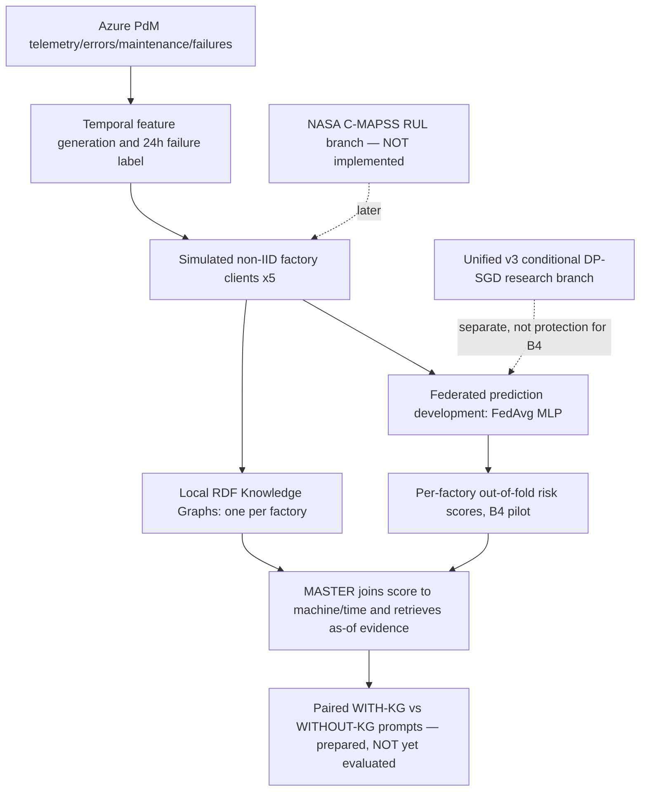

# Implemented / planned architecture

The Azure pipeline targets: failure occurring strictly in `(t, t + 24 hours]`. Measured PR-AUC is *average precision*, not accuracy. The reported B4 architecture uses 25 current-row features, local StandardScaler per development factory, 25→32→8→1 MLP, FedAvg, and four leave-one-development-factory-out folds (three training clients each). The selected B4 scores are fold-specific; a new general-purpose unseen-client checkpoint has not been trained/saved in this package.

The KG retrieval is as-of; graph evidence represents documented historical observations, not causal proof. The LLM layer is a prepared next-stage **experiment**, not a validated system feature.
